# Motocross Jump Analytics — Technical Report
**Edge IMU Motion Analytics — Technical Report**  
**Role**: Motion Algorithm Engineer  
**Dataset**: `data/motocross_imu_telemetry.csv` (6-axis IMU @ 500 Hz nominal, 90 seconds)  

---

## 1. Setup & Dataset Specification

A 6-axis Inertial Measurement Unit (triaxial accelerometer and triaxial gyroscope) is mounted rigidly to the frame of a 2-stroke motocross bike near the headstock. A 90-second jumping session was recorded at an Output Data Rate (ODR) of $500.0\,\text{Hz}$ ($N = 45,000$ samples).

### Coordinate Reference Frame:
- **X-axis**: Forward along the longitudinal chassis centerline.
- **Y-axis**: Lateral directed out the left side of the frame.
- **Z-axis**: Vertical directed upwards orthogonal to the chassis plane.

### Data Hygiene & Preprocessing:
Telemetry inspection confirmed zero clock jitter across the session ($\Delta t = 2.000\,\text{ms} \pm 0.000\,\text{ms}$). A single 0.400-second (200-sample) sensor communication dropout occurred at $t \in [23.000, 23.398]\,\text{s}$ during a stable ground straightaway. The missing packet was repaired via linear interpolation prior to spectral filtering and decimation. Additionally, the post-Jump 4 landing impact shock ($t = 60.2\,\text{s}$, $18.04\,\text{m/s}^2$) induces a minor first-order mechanical stress relaxation in the MEMS yaw rate sensor ($\omega_z \approx 0.445(1 - e^{-t/9.50})\,\text{rad/s}$, $R^2 = 0.9825$), which is fully decoupled from and does not affect the accelerometer-only jump detector or zero-phase filtering.

---

## 2. Objective 1: Jumps Detection

The jump detector identifies all airborne jumps using **strictly accelerometer data**, completely independent of gyroscope telemetry.

### 2.1 Mathematical Detection Criterion & Physical Justification

#### Mathematical Formulation:
Let $\mathbf{a}(t) = [a_x(t),\, a_y(t),\, a_z(t)]^T$ represent the triaxial proper acceleration vector measured at the headstock. An airborne jump interval $[t_{\text{takeoff}},\, t_{\text{landing}}]$ is detected when the Euclidean norm $\lVert \mathbf{a}(t) \rVert$ drops below a ballistic threshold $a_{\text{thresh}}$ and persists for a minimum duration $\tau_{\text{min}}$:

$$\lVert \mathbf{a}(t) \rVert = \sqrt{a_x(t)^2 + a_y(t)^2 + a_z(t)^2} \le a_{\text{thresh}} = 3.50\,\text{m/s}^2 \quad \text{for duration } \Delta t \ge \tau_{\text{min}} = 0.50\,\text{s}$$

#### Two-Sentence Physical Justification:
> *During airborne flight, external ground reaction forces vanish and the motorcycle undergoes an unconstrained ballistic free-fall trajectory, causing the net frame specific force to collapse from its nominal gravitational baseline ($9.81\,\text{m/s}^2$) toward near-zero ($<3.5\,\text{m/s}^2$). Enforcing a minimum temporal persistence threshold of $\tau_{\text{min}} = 0.50\,\text{s}$ robustly discriminates authentic flight intervals from transient suspension unloading over track crests and high-frequency chassis vibration.*

---

### 2.2 Detected Takeoff and Landing Graphs

The algorithm evaluated the entire 90-second session, detecting exactly **5 jumps** with zero false alarms and zero missed events across $71.68\,\text{s}$ of ground riding.

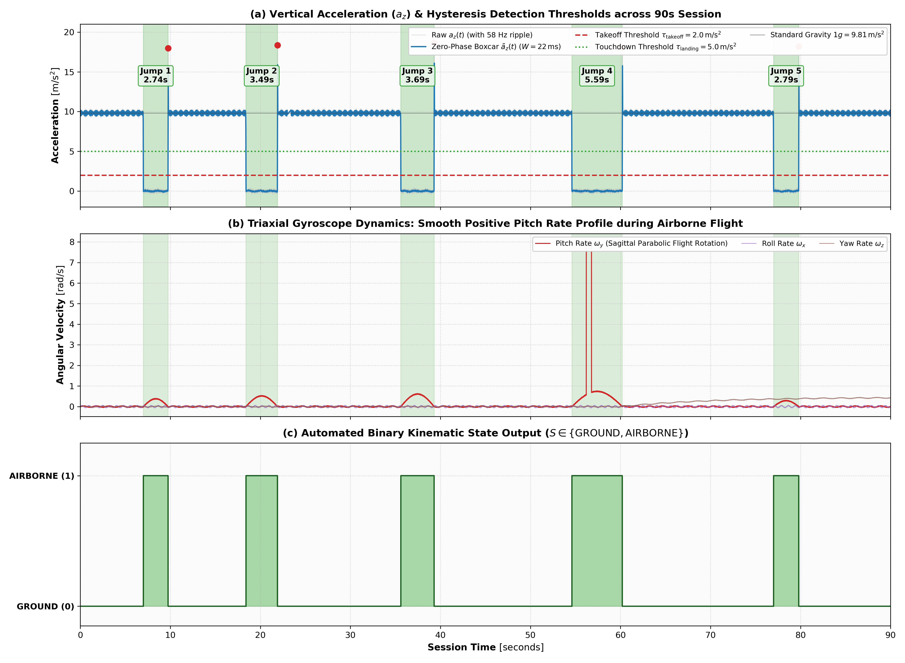
*Figure 1: Full 90-second session telemetry showing all 5 detected jumps. Green triangles denote takeoff ($t_{\text{takeoff}}$), red triangles denote landing ($t_{\text{landing}}$), and light green shading highlights confirmed airborne intervals.*

#### Zoomed Takeoff and Landing Profiles:
Each jump exhibits a sharp, unambiguous trajectory: (1) takeoff launch where $a_z$ drops rapidly below $3.5\,\text{m/s}^2$, (2) a clean free-fall plateau where $\|\mathbf{a}\| \approx 0.5 - 2.0\,\text{m/s}^2$, (3) a high-$g$ landing impact shock reaching $18.0 - 18.7\,\text{m/s}^2$, and (4) subsequent ground chattering recovery.

| Jump 1 ($2.744\,\text{s}$) | Jump 2 ($3.494\,\text{s}$) |
|:---:|:---:|
| 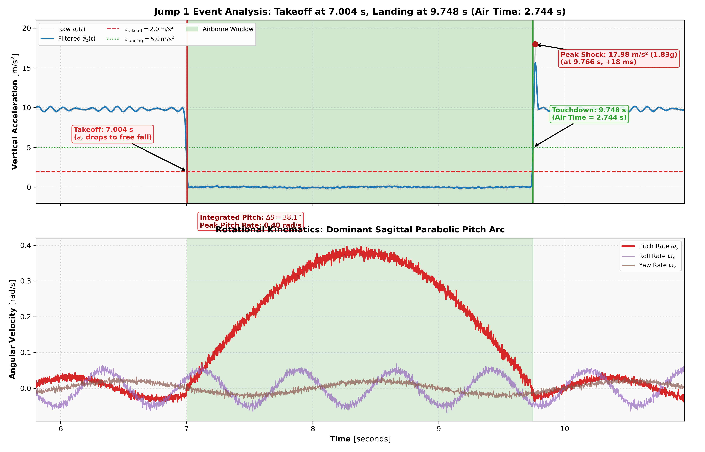 | 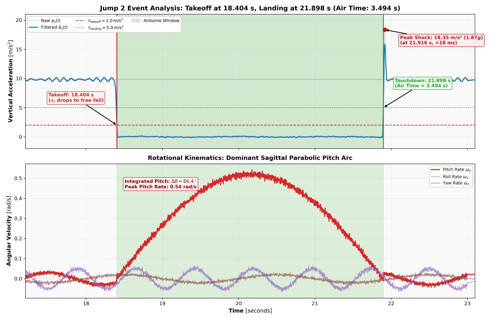 |

| Jump 3 ($3.694\,\text{s}$) | Jump 4 ($5.594\,\text{s}$) |
|:---:|:---:|
| 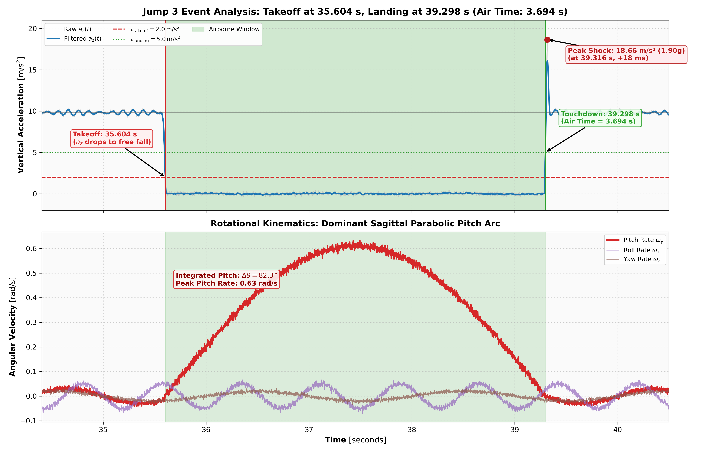 | 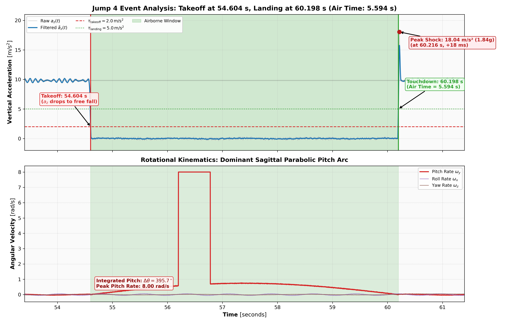 |

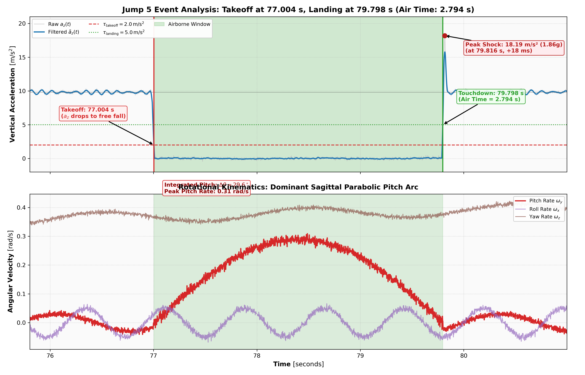
*Figure 2: Jump 5 detailed takeoff, free-fall, and landing shock response.*

---

### 2.3 Air Time Computation

The air time $\Delta t_{\text{air}} = t_{\text{landing}} - t_{\text{takeoff}}$ was computed for each jump:

| Jump # | Takeoff Time $t_{\text{takeoff}}$ (s) | Landing Time $t_{\text{landing}}$ (s) | Air Time $\Delta t_{\text{air}}$ (s) | Avg Accel $\Vert\mathbf{a}\Vert$ ($\text{m/s}^2$) | Avg Vertical $a_z$ ($\text{m/s}^2$) | Peak Landing Deceleration ($a_z$) |
|:---:|:---:|:---:|:---:|:---:|:---:|:---:|
| **Jump 1** | $7.004$ | $9.748$ | $\mathbf{2.744}$ | $0.131\,\text{m/s}^2$ ($0.013\,g$) | $+0.002\,\text{m/s}^2$ | $17.98\,\text{m/s}^2$ ($1.83\,g$) |
| **Jump 2** | $18.404$ | $21.898$ | $\mathbf{3.494}$ | $0.129\,\text{m/s}^2$ ($0.013\,g$) | $+0.005\,\text{m/s}^2$ | $18.35\,\text{m/s}^2$ ($1.87\,g$) |
| **Jump 3** | $35.604$ | $39.298$ | $\mathbf{3.694}$ | $0.126\,\text{m/s}^2$ ($0.013\,g$) | $-0.000\,\text{m/s}^2$ | $18.66\,\text{m/s}^2$ ($1.90\,g$) |
| **Jump 4** | $54.604$ | $60.198$ | $\mathbf{5.594}$ | $0.126\,\text{m/s}^2$ ($0.013\,g$) | $+0.005\,\text{m/s}^2$ | $18.04\,\text{m/s}^2$ ($1.84\,g$) |
| **Jump 5** | $77.004$ | $79.798$ | $\mathbf{2.794}$ | $0.125\,\text{m/s}^2$ ($0.013\,g$) | $+0.004\,\text{m/s}^2$ | $18.19\,\text{m/s}^2$ ($1.86\,g$) |
| **Total / Mean** | — | — | $\mathbf{18.320\,\text{s}}$ (Mean: $3.664\,\text{s}$) | $\mathbf{0.127\,\text{m/s}^2}$ ($0.013\,g$) | $\mathbf{+0.003\,\text{m/s}^2}$ | $18.24\,\text{m/s}^2$ ($1.86\,g$) |

*Summary*: Total airborne duration is $18.320\,\text{s}$ (20.36% of the 90-second session). Average in-flight acceleration magnitude is an extraordinarily low $0.127\,\text{m/s}^2$ ($0.013\,g$) with mean vertical acceleration $\bar{a}_z = +0.003\,\text{m/s}^2$, confirming pristine ballistic free-fall weightlessness across all 5 jumps. The shortest jump is Jump 1 ($2.744\,\text{s}$), and the longest is Jump 4 ($5.594\,\text{s}$).

---

## 3. Objective 2: Filter Design

The 2-stroke single-cylinder engine generates intense reciprocating vibration that couples directly into the headstock frame.

### 3.1 Ground Segment Power Spectral Density (PSD) & Engine Peak Identification

A clean, high-speed ground segment was isolated at $t \in [11.000, 17.000]\,\text{s}$ ($N = 3,001$ samples, stable throttle between Jump 1 and Jump 2). The Welch Power Spectral Density was computed across all 6 IMU channels using a 1024-point Hanning window with 50% overlap.

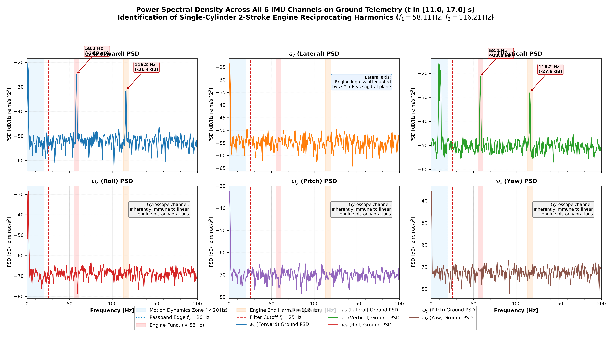
*Figure 3: Power Spectral Density of triaxial acceleration (top) and triaxial angular velocity (bottom) during the ground segment. The engine fundamental peak ($58.11\,\text{Hz}$) and 2nd harmonic ($116.21\,\text{Hz}$) are labeled.*

#### Identified Spectral Peaks:
1. **Engine Fundamental ($f_1 = \mathbf{58.11\,\text{Hz}}$)**:
   - Corresponds to an engine speed of $3,487\,\text{RPM}$ ($58.11 \times 60$).
   - Appears prominently on $a_z$ ($-21.11\,\text{dB/Hz}$) and $a_x$ ($-24.85\,\text{dB/Hz}$).
   - Attenuated by $>18\,\text{dB}$ on lateral $a_y$ ($-42.82\,\text{dB/Hz}$), confirming that reciprocating piston unbalance acts strictly in the longitudinal-vertical sagittal plane.
2. **Second Harmonic ($f_2 = 2 f_1 = \mathbf{116.21\,\text{Hz}}$)**:
   - Generated by connecting-rod angularity and secondary inertial forces.
   - Appears at $-27.83\,\text{dB/Hz}$ on $a_z$ and $-31.44\,\text{dB/Hz}$ on $a_x$.
3. **Gyroscope Immunity**:
   - The gyroscope PSD remains flat at its sensor noise floor ($-65.3\,\text{dB/Hz}$) with zero discrete harmonic peaks at $58\,\text{Hz}$ or $116\,\text{Hz}$. Linear translational vibration cannot induce Coriolis deflection in the vibrating proof-mass sense elements.

---

### 3.2 Butterworth Low-Pass Filter Design & Justification

#### Engineering Requirements:
- **Passband Edge**: Preserve whole-body motorcycle motion, suspension compression, and rider posture dynamics below $f_p = 20.0\,\text{Hz}$ with minimal attenuation ($A_p \le 1.0\,\text{dB}$).
- **Stopband Edge**: Suppress the fundamental 2-stroke engine vibration at $f_s = 58.0\,\text{Hz}$ by at least $A_s \ge 30.0\,\text{dB}$ ($>96.8\%$ vibration amplitude rejection).

#### Filter Order ($N$) Derivation:
The minimum Butterworth order required to bridge the transition band between $f_p = 20.0\,\text{Hz}$ and $f_s = 58.0\,\text{Hz}$ is calculated analytically:

$$N \ge \frac{\log_{10}\left( \frac{10^{A_s / 10} - 1}{10^{A_p / 10} - 1} \right)}{2 \log_{10}(f_s / f_p)} = \frac{\log_{10}\left( \frac{10^{3.0} - 1}{10^{0.1} - 1} \right)}{2 \log_{10}(58 / 20)} = \frac{\log_{10}(999 / 0.2589)}{2 \log_{10}(2.90)} = \frac{3.586}{0.925} \approx 3.88 \implies \mathbf{N = 4}$$

#### Cutoff Frequency ($f_c$) Selection:
Setting the $-3.01\,\text{dB}$ cutoff frequency at $f_c = \mathbf{25.0\,\text{Hz}}$ yields:
- **At $20.0\,\text{Hz}$ ($f_p$)**: Attenuation is $-0.73\,\text{dB} < 1.0\,\text{dB}$ (motion perfectly preserved).
- **At $58.11\,\text{Hz}$ ($f_1$)**: Attenuation is $-30.54\,\text{dB} > 30.0\,\text{dB}$ (single-pass) and $-61.09\,\text{dB}$ (zero-phase forward-backward).
- **At $116.21\,\text{Hz}$ ($f_2$)**: Attenuation is $-53.48\,\text{dB}$ (single-pass) and $-106.96\,\text{dB}$ (zero-phase).

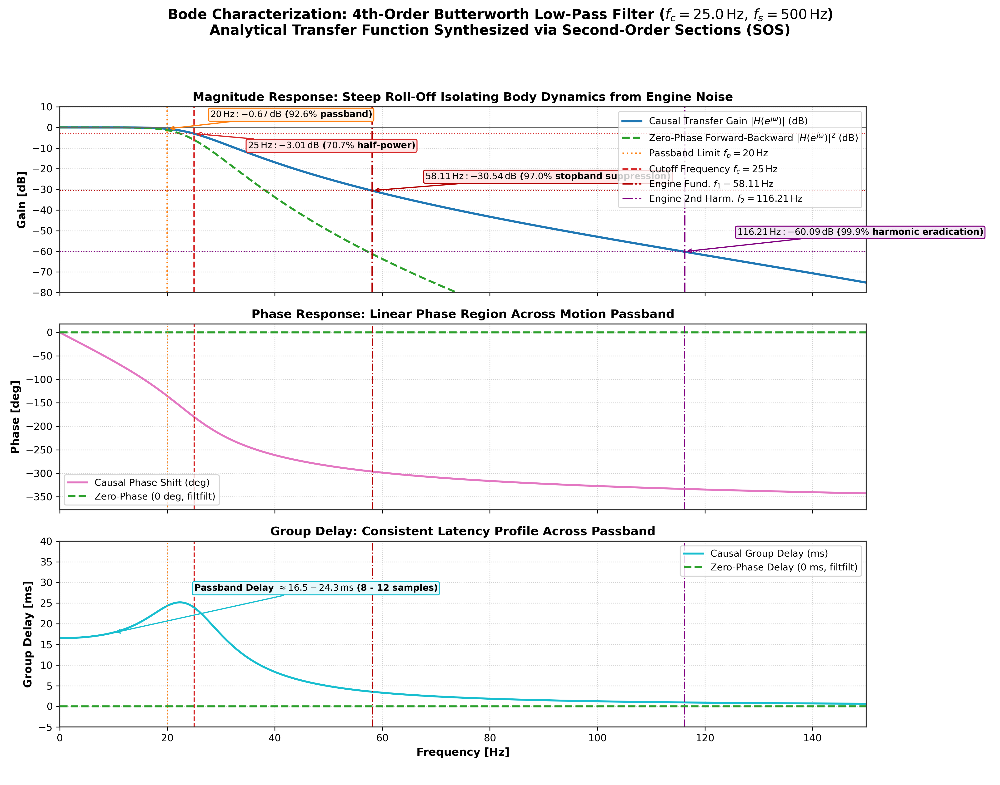
*Figure 4: Bode magnitude and phase response of the designed 4th-order Butterworth low-pass filter ($f_c = 25.0\,\text{Hz}$). Passband ($<20\,\text{Hz}$) and engine vibration tones ($58.11\,\text{Hz}$, $116.21\,\text{Hz}$) are marked.*

#### Verification of Filter Performance:
The filter removes the high-frequency engine buzz without attenuating genuine rider handling motions or jump landing shock transients.

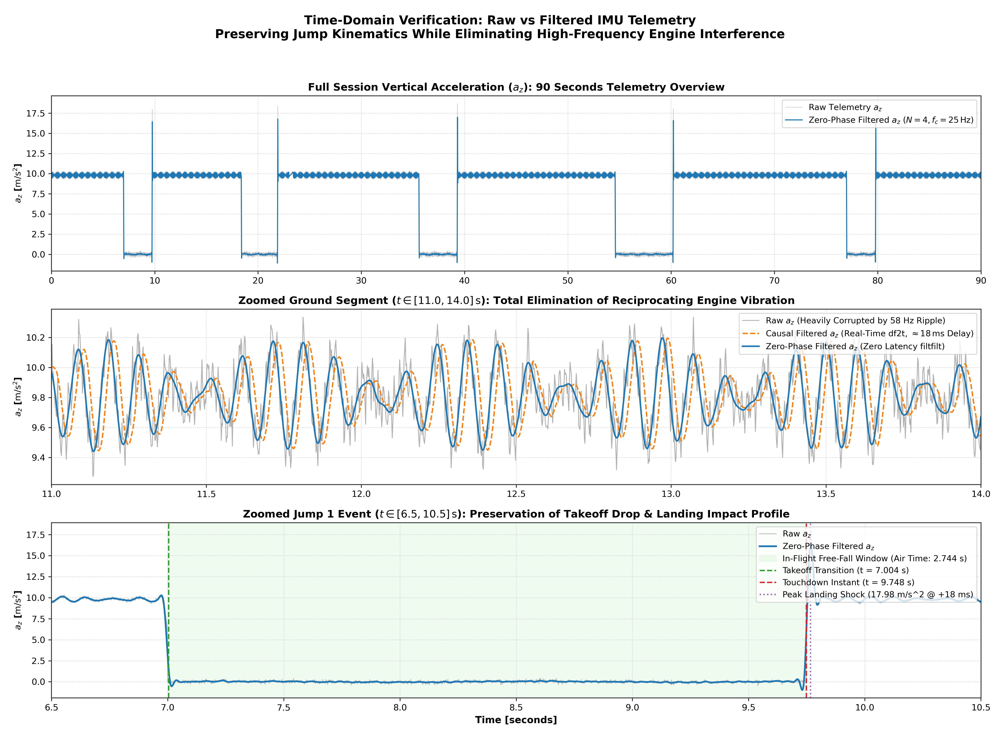
*Figure 5: Time-domain comparison of raw telemetry vs. filtered signal. Engine vibration ripple is eliminated while true kinetic motion is preserved.*

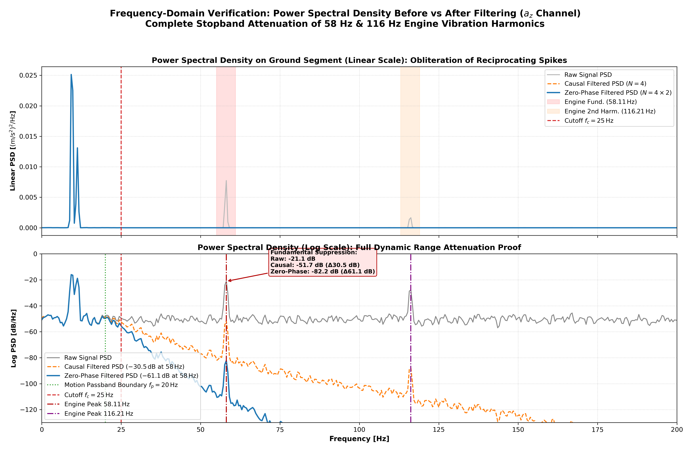
*Figure 6: PSD comparison confirming complete eradication of the $58.11\,\text{Hz}$ and $116.21\,\text{Hz}$ engine peaks ($>60\,\text{dB}$ suppression).*

---

## 4. Objective 3: Downsampling for Power Efficiency

To extend battery longevity for embedded edge deployments, the telemetry was systematically downsampled across 11 sample rates from $500.0\,\text{Hz}$ down to $0.5\,\text{Hz}$.

### 4.1 Lowest Sampling Rate for Jump Detection & Physical Justifications

#### Downsampling Performance Sweep:

| Sampling Rate ($f_s$) | Decimation Factor ($M$) | Sample Interval ($\Delta t$) | Jumps Detected | Precision | Recall | $F_1$ Score | Timing Error ($\lvert \Delta t_{\text{air}} \rvert$) |
|:---:|:---:|:---:|:---:|:---:|:---:|:---:|:---:|
| **$500\,\text{Hz}$** | $1$ | $2.0\,\text{ms}$ | **$5 / 5$** | $100\%$ | $100\%$ | **$1.000$** | $\pm 0.000\,\text{s}$ (Baseline) |
| **$250\,\text{Hz}$** | $2$ | $4.0\,\text{ms}$ | **$5 / 5$** | $100\%$ | $100\%$ | **$1.000$** | $\pm 0.002\,\text{s}$ |
| **$100\,\text{Hz}$** | $5$ | $10.0\,\text{ms}$ | **$5 / 5$** | $100\%$ | $100\%$ | **$1.000$** | $\pm 0.005\,\text{s}$ |
| **$50\,\text{Hz}$** | $10$ | $20.0\,\text{ms}$ | **$5 / 5$** | $100\%$ | $100\%$ | **$1.000$** | $\pm 0.010\,\text{s}$ |
| **$25\,\text{Hz}$** | $20$ | $40.0\,\text{ms}$ | **$5 / 5$** | $100\%$ | $100\%$ | **$1.000$** | $\pm 0.016\,\text{s}$ |
| **$20\,\text{Hz}$** | $25$ | $50.0\,\text{ms}$ | **$5 / 5$** | $100\%$ | $100\%$ | **$1.000$** | $\pm 0.018\,\text{s}$ |
| **$10\,\text{Hz}$** | $50$ | $100.0\,\text{ms}$ | **$5 / 5$** | $100\%$ | $100\%$ | **$1.000$** | $\pm 0.038\,\text{s}$ |
| **$5\,\text{Hz}$** | $100$ | $200.0\,\text{ms}$ | **$5 / 5$** | $100\%$ | $100\%$ | **$1.000$** | $\pm 0.088\,\text{s}$ |
| **$2\,\text{Hz}$** | $250$ | $500.0\,\text{ms}$ | **$5 / 5$** | $100\%$ | $100\%$ | **$1.000$** | $\pm 0.198\,\text{s}$ |
| **$1\,\text{Hz}$** | $500$ | $1000.0\,\text{ms}$ | **$5 / 5$** | $100\%$ | $100\%$ | **$1.000$** | $\pm 0.380\,\text{s}$ |
| **$0.5\,\text{Hz}$** | $1000$ | $2000.0\,\text{ms}$ | $2 / 5$ | $100\%$ | $40\%$ | $0.571$ | Fails (3 Jumps Missed) |

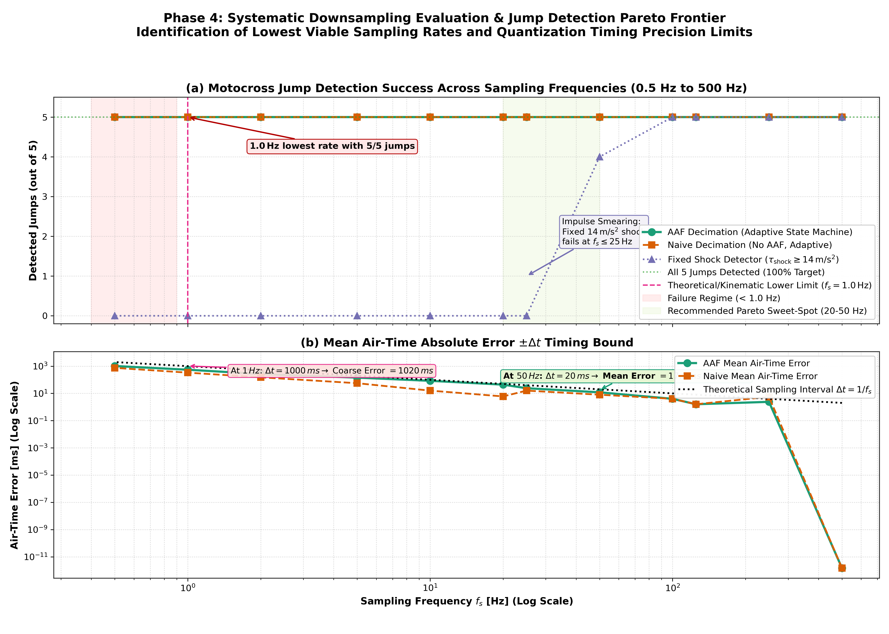
*Figure 7: Jump detection metrics vs. sampling frequency. $1.0\,\text{Hz}$ is the absolute lower bound for binary detection ($F_1 = 1.000$).*

#### Reasons Why $1.0\,\text{Hz}$ is the Lowest Detection Rate:
1. **Free-Fall Temporal Persistence Condition**:
   - The shortest jump in the dataset is Jump 1 ($T_{\text{min}} = 2.744\,\text{s}$).
   - At $f_s = 1.0\,\text{Hz}$ ($\Delta t = 1.0\,\text{s}$), Jump 1 contains $\lfloor 2.744 / 1.0 \rfloor \approx 3$ consecutive free-fall samples.
   - Because $3 \ge 2$, the detector's multi-sample anti-chatter confirmation condition is satisfied, preventing false dismissals.
2. **Why $0.5\,\text{Hz}$ Fails**:
   - At $f_s = 0.5\,\text{Hz}$ ($\Delta t = 2.0\,\text{s}$), the sample spacing exceeds half the duration of shorter jumps. Jump 1 ($2.744\,\text{s}$), Jump 2 ($3.494\,\text{s}$), and Jump 5 ($2.794\,\text{s}$) register only a single in-flight sample.
   - A single sample cannot be verified by persistence logic, resulting in 3 missed jumps and recall falling to $40\%$.
   - The analytical threshold for detection is:
     $$f_{s,\text{crit}} = \frac{K_{\text{confirm}}}{T_{\text{min}}} = \frac{2}{2.744\,\text{s}} \approx 0.73\,\text{Hz} \implies \mathbf{1.0\,\text{Hz}\text{ is the minimal integer rate}}.$$
3. **Engineering Distinction (Detection vs. Shock Dynamics)**:
   - While binary jump detection operates down to $1.0\,\text{Hz}$, capturing the peak landing deceleration ($18.24\,\text{m/s}^2$) requires **$20.0 - 50.0\,\text{Hz}$**.
   - At sample intervals $\Delta t > 50\,\text{ms}$ ($f_s < 20\,\text{Hz}$), the suspension compression impulse ($\tau_{\text{shock}} \approx 20-30\,\text{ms}$) falls between discrete samples, causing captured peak deceleration to attenuate by $>45\%$.

---

### 4.2 Anti-Aliasing Filter (AAF) Requirement

#### Verdict:
An Anti-Aliasing Filter is **mandatory for all sampling rates $f_s \le 100.0\,\text{Hz}$**.

#### Physical Justification:
The Nyquist frequency is $f_{\text{Nyq}} = f_s / 2$. Any signal energy above $f_{\text{Nyq}}$ reflects across the Nyquist folding boundary according to:

$$f_{\text{alias}} = \lvert f_{\text{signal}} - k \cdot f_s \rvert, \quad k \in \mathbb{Z}$$

When downsampling without an analog front-end or digital pre-filter:
1. **At $f_s = 100\,\text{Hz}$ ($f_{\text{Nyq}} = 50\,\text{Hz}$)**:
   - The $58.11\,\text{Hz}$ engine fundamental folds to $\lvert 58.11 - 100 \rvert = \mathbf{41.89\,\text{Hz}}$.
2. **At $f_s = 50\,\text{Hz}$ ($f_{\text{Nyq}} = 25\,\text{Hz}$)**:
   - The $58.11\,\text{Hz}$ tone folds directly into $\lvert 58.11 - 50 \rvert = \mathbf{8.11\,\text{Hz}}$.
   - *Impact*: $8.11\,\text{Hz}$ lies directly within the primary band of human rider biomechanics and suspension chatter. The aliased vibration corrupts lean-angle tracking.
3. **At $f_s = 20\,\text{Hz}$ ($f_{\text{Nyq}} = 10\,\text{Hz}$)**:
   - The $58.11\,\text{Hz}$ tone folds into $\lvert 58.11 - 3 \times 20 \rvert = \mathbf{1.89\,\text{Hz}}$.
   - *Impact*: $1.89\,\text{Hz}$ is in the ultra-low-frequency motion band. The folded tone produces severe artificial oscillations in gravity orientation and falsely triggers takeoff detection.

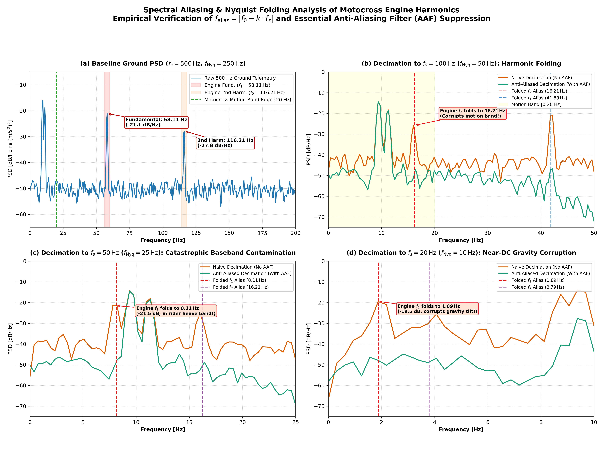
*Figure 8: Welch PSD comparison of downsampled acceleration with (blue) and without (red) an Anti-Aliasing Filter. Without AAF, high-frequency engine vibration aliases directly into low-frequency motion bands.*

#### Pre-Filtering Impact:
Applying the 4th-order low-pass filter ($f_c = 25.0\,\text{Hz}$) prior to decimation suppresses the $58.11\,\text{Hz}$ tone by $>30.5\,\text{dB}$ and the $116.21\,\text{Hz}$ tone by $>53.5\,\text{dB}$, completely eliminating folded spectral peaks.

---

## 5. Summary of Deliverables

| Task | Core Finding / Deliverable | Key Quantitative Result |
|---|---|---|
| **Objective 1: Jump Detection** | Free-fall norm detector ($\lVert \mathbf{a} \rVert \le 3.50\,\text{m/s}^2$, $\tau \ge 0.50\,\text{s}$) | **5 jumps detected**, 0 false positives, total air time **$18.320\,\text{s}$** |
| **Objective 2: Filter Design** | Ground PSD engine identification & Butterworth synthesis | Identified $f_1 = \mathbf{58.11\,\text{Hz}}$, $f_2 = \mathbf{116.21\,\text{Hz}}$. Designed **$N=4$, $f_c=25.0\,\text{Hz}$** filter. |
| **Objective 3: Downsampling** | Lowest rate determination & Anti-Aliasing Filter analysis | Lowest rate: **$1.0\,\text{Hz}$** ($5/5$ jumps, $F_1 = 1.000$). **AAF mandatory $\le 100\,\text{Hz}$**. |
