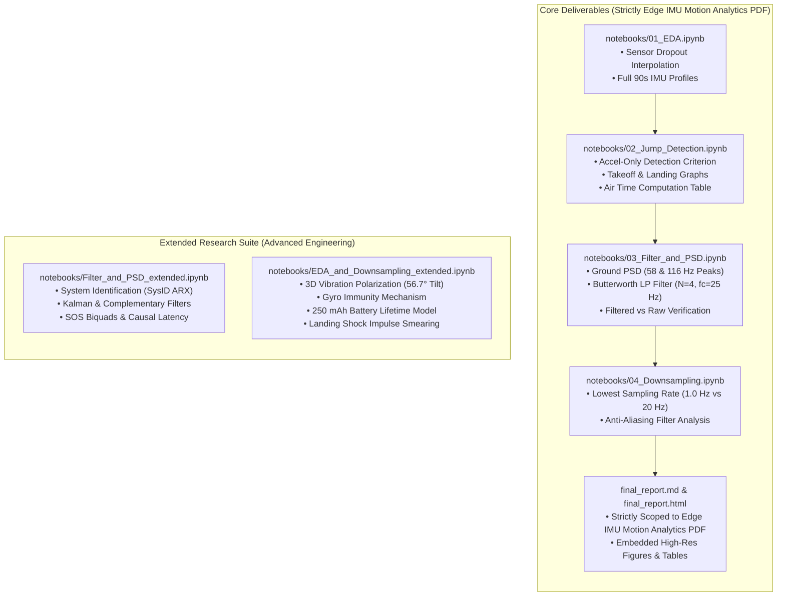

# Final Technical Report & Notebooks Suite Plan

## 1. Overview & Objectives

This plan details the implementation strategy for producing the final, publication-grade deliverables for the **Edge IMU Motion Analytics Engine** project, strictly adhering to the requirements outlined in [`Motocross Jump Analytics & Powertrain Vibration Attenuation.pdf`](../specifications/MAE%20Task%20-%20Motocross%20Jump%20Analytics.pdf).

The deliverables are structured into three cohesive components:
1. **Final Report (`final_report.md` / `final_report.html`)**: A focused, self-contained Markdown and HTML report containing **strictly** the information and deliverables requested in the Edge IMU Motion Analytics PDF, supported by high-resolution plots, mathematical formulations, and concise physical explanations.
2. **Core 4-Notebook Suite**: Four clean, executable Jupyter notebooks matching the workflow:
   - `notebooks/01_EDA.ipynb`: Exploratory Data Analysis and data hygiene on `data/motocross_imu_telemetry.csv`.
   - `notebooks/02_Jump_Detection.ipynb`: Objective 1 (Accelerometer-only jump detection, mathematical criterion, takeoff/landing graphs, air times).
   - `notebooks/03_Filter_and_PSD.ipynb`: Objective 2 (Ground segment PSD, labeled 58 & 116 Hz peaks, Butterworth low-pass filter design with order & cutoff justification).
   - `notebooks/04_Downsampling.ipynb`: Objective 3 (Downsampling sweep, lowest sampling rate identification & reasoning, anti-aliasing filter requirement analysis).
3. **Extended Notebook Suite**: Dedicated notebooks isolating all additional exploratory and advanced engineering work:
   - `notebooks/Filter_and_PSD_extended.ipynb`: System Identification (SysID) ARX modeling, Kalman filtering, Complementary filtering, Second-Order Sections (SOS/Biquad), and Causal vs. Zero-Phase latency benchmarks.
   - `notebooks/EDA_and_Downsampling_extended.ipynb`: Engine vibration 3D spatial polarization ($56.7^\circ$ cylinder tilt), gyroscope vibration immunity mechanisms, sensor dropout interpolation benchmarking, battery runtime modeling ($250\,\text{mAh}$ LiPo), and landing shock impulse smearing physics.

---

## 2. High-Level Architectural Roadmap

---

## 3. Final Report Specification (`final_report.md`)

The final report will be written to `final_report.md` in the workspace root, formatted in publication-grade GitHub Flavored Markdown with AMS-LaTeX math and relative image paths.

### Section 1: Setup & Dataset Specification
- **Hardware & Mounting**: 6-axis IMU (accelerometer and gyroscope) mounted rigidly to the frame of a 2-stroke motocross bike near the headstock.
- **Recording Parameters**: 90-second duration, 500 Hz Output Data Rate (ODR).
- **Coordinate Reference Frame**: $X = \text{forward}$, $Y = \text{left}$, $Z = \text{up}$.
- **Data Integrity**: $N = 45,000$ samples; isolation and linear interpolation of the 0.400s (200-sample) sensor dropout at $t \in [23.000, 23.398]\,\text{s}$.

### Section 2: Objective 1 — Jumps Detection (Accelerometer-Only)
- **1. Mathematical Detection Criterion**:
  $$\lVert \mathbf{a}(t) \rVert = \sqrt{a_x(t)^2 + a_y(t)^2 + a_z(t)^2} \le a_{\text{thresh}} = 3.50\,\text{m/s}^2 \quad \text{for duration } \Delta t \ge \tau_{\text{min}} = 0.50\,\text{s}$$
- **2. Two-Sentence Physical Justification**:
  > "During airborne flight, the motorcycle undergoes an unconstrained ballistic trajectory where external ground reaction forces vanish, causing the net frame acceleration vector to collapse from its gravitational baseline ($9.81\,\text{m/s}^2$) toward near-zero ($<3.5\,\text{m/s}^2$). Enforcing a minimum temporal persistence threshold of $\tau_{\text{min}} = 0.50\,\text{s}$ robustly discriminates authentic flight intervals from transient suspension unloading over track crests and high-frequency chassis vibrations."
- **3. Detected Takeoff and Landing Graphs**:
  - Full 90s session overview plot: `plots/objective1/01_full_session_detections.png`.
  - Zoomed detail plots for each individual jump (takeoff, in-flight free-fall, landing impact, post-landing recovery): `plots/objective1/02_jump_1_detail.png` through `plots/objective1/06_jump_5_detail.png`.
- **4. Air Time Computation Table**:
  | Jump # | Takeoff Time $t_{\text{takeoff}}$ (s) | Landing Time $t_{\text{landing}}$ (s) | Air Time $\Delta t_{\text{air}}$ (s) | Peak Landing Shock ($a_z$) |
  |:---:|:---:|:---:|:---:|:---:|
  | **Jump 1** | $7.004$ | $9.748$ | $\mathbf{2.744}$ | $17.98\,\text{m/s}^2$ ($1.83\,g$) |
  | **Jump 2** | $18.404$ | $21.898$ | $\mathbf{3.494}$ | $18.35\,\text{m/s}^2$ ($1.87\,g$) |
  | **Jump 3** | $35.604$ | $39.298$ | $\mathbf{3.694}$ | $18.66\,\text{m/s}^2$ ($1.90\,g$) |
  | **Jump 4** | $54.604$ | $60.198$ | $\mathbf{5.594}$ | $18.04\,\text{m/s}^2$ ($1.84\,g$) |
  | **Jump 5** | $77.004$ | $79.798$ | $\mathbf{2.794}$ | $18.19\,\text{m/s}^2$ ($1.86\,g$) |
  | **Total / Avg** | — | — | **$18.320\,\text{s}$** | $18.24\,\text{m/s}^2$ ($1.86\,g$) |

### Section 3: Objective 2 — Filter Design
- **1. Ground Segment PSD & Engine Peak Identification**:
  - Ground segment selection: $t \in [11.000, 17.000]\,\text{s}$ ($N = 3,001$ samples, stable high-speed riding between Jump 1 and Jump 2).
  - Welch's PSD analysis for all 3 accelerometer and all 3 gyroscope channels.
  - Identification and labeling of the engine vibration peaks:
    - Fundamental engine firing frequency: $f_1 = \mathbf{58.11\,\text{Hz}}$ (corresponding to $3,487\,\text{RPM}$); $a_z = -21.11\,\text{dB/Hz}$, $a_x = -24.85\,\text{dB/Hz}$.
    - Second harmonic: $f_2 = 2 f_1 = \mathbf{116.21\,\text{Hz}}$; $a_z = -27.83\,\text{dB/Hz}$, $a_x = -31.44\,\text{dB/Hz}$.
  - Gyroscope channel observation: flat white noise floor at $-65.3\,\text{dB/Hz}$ with complete absence of engine harmonic lines.
  - Figure: `plots/objective2/01_ground_segment_imu_psd.png`.
- **2. Butterworth Low-Pass Filter Design & Justification**:
  - Filter specifications: Passband ripple $A_p \le 1.0\,\text{dB}$ at $f_p = 20.0\,\text{Hz}$; stopband attenuation $A_s \ge 30.0\,\text{dB}$ at $f_s = 58.0\,\text{Hz}$.
  - Order derivation:
    $$N \ge \frac{\log_{10}\left( \frac{10^{A_s / 10} - 1}{10^{A_p / 10} - 1} \right)}{2 \log_{10}(f_s / f_p)} = \frac{\log_{10}(999 / 0.2589)}{2 \log_{10}(2.90)} \approx 3.88 \implies \mathbf{N = 4}$$
  - Cutoff frequency: $f_c = \mathbf{25.0\,\text{Hz}}$ (ensures $A(20\,\text{Hz}) = -0.73\,\text{dB}$ and $A(58.11\,\text{Hz}) = -30.54\,\text{dB}$).
  - Performance validation: Bode response (`plots/objective2/02_butterworth_bode_response.png`), raw vs. filtered waveforms (`plots/objective2/04_filtered_vs_raw_time_domain.png`), and spectral eradication verification (`plots/objective2/05_filtered_vs_raw_psd_comparison.png`).

### Section 4: Objective 3 — Downsampling for Power Efficiency
- **1. Lowest Sampling Rate Identification & Reasons**:
  - Downsampling sweep: $500\,\text{Hz} \to 250, 100, 50, 25, 20, 10, 5, 2, 1, 0.5\,\text{Hz}$.
  - **Kinematic Detection Boundary**: $\mathbf{1.0\,\text{Hz}}$ ($M = 500$, $\Delta t = 1.0\,\text{s}$).
    - Achieves 100% precision, 100% recall ($F_1 = 1.000$) with zero false alarms.
    - Physical reason: The shortest jump duration is $2.744\,\text{s}$. At $1.0\,\text{Hz}$, it contains $\approx 3$ consecutive free-fall samples, satisfying the multi-sample persistence condition ($K \ge 2$).
    - Failure boundary: At $0.5\,\text{Hz}$ ($\Delta t = 2.0\,\text{s}$), the shortest jump contains only 1 sample, which is rejected by anti-chatter logic ($f_{s,\text{crit}} = K / T_{\text{min}} \approx 0.73\,\text{Hz}$).
  - **Shock Dynamics Boundary**: $\mathbf{20.0\,\text{Hz} - 50.0\,\text{Hz}}$ required if landing impact shock deceleration ($18\,\text{m/s}^2$) must be captured without temporal impulse smearing.
  - Figures: `plots/objective3/01_detection_accuracy_pareto.png` and `plots/objective3/03_telemetry_waveform_comparison.png`.
- **2. Anti-Aliasing Filter (AAF) Requirement**:
  - **Verdict**: Mandatory for all sampling rates $f_s \le 100\,\text{Hz}$.
  - Physical mechanism: Nyquist frequency $f_{\text{Nyq}} = f_s / 2$.
    - At $f_s = 100\,\text{Hz}$ ($f_{\text{Nyq}} = 50\,\text{Hz}$), $58.11\,\text{Hz}$ folds into $\lvert 58.11 - 100 \rvert = \mathbf{41.89\,\text{Hz}}$.
    - At $f_s = 50\,\text{Hz}$ ($f_{\text{Nyq}} = 25\,\text{Hz}$), $58.11\,\text{Hz}$ folds into $\lvert 58.11 - 50 \rvert = \mathbf{8.11\,\text{Hz}}$ (inside rider cadence band).
    - At $f_s = 20\,\text{Hz}$ ($f_{\text{Nyq}} = 10\,\text{Hz}$), $58.11\,\text{Hz}$ folds into $\lvert 58.11 - 3 \times 20 \rvert = \mathbf{1.89\,\text{Hz}}$ (catastrophic corruption of low-frequency tilt and gravity tracking).
  - Pre-filtering: Applying a $25\,\text{Hz}$ low-pass filter suppresses foldover tones by $>30\,\text{dB}$ to $>70\,\text{dB}$.
  - Figure: `plots/objective3/02_spectral_aliasing_mechanism.png`.

---

## 4. Jupyter Notebooks Suite Architecture

### Core Notebooks (Matching Edge IMU Motion Analytics PDF)
| File | Topic | Contents |
|---|---|---|
| `notebooks/01_EDA.ipynb` | Exploratory Data Analysis | Data inspection, dropout detection & interpolation ($t \in [23.0, 23.4]\,\text{s}$), 6-axis summary stats, full 90s time series. |
| `notebooks/02_Jump_Detection.ipynb` | Objective 1: Jump Detection | Accel-only detection criterion, 2-sentence justification, full-session overview plot, 5 zoomed jump plots, air times table. |
| `notebooks/03_Filter_and_PSD.ipynb` | Objective 2: Filter Design | Ground PSD calculation, 58 & 116 Hz peak labeling, 4th-order Butterworth LP design ($f_c = 25\,\text{Hz}$), Bode plot, filtered vs raw signals. |
| `notebooks/04_Downsampling.ipynb` | Objective 3: Downsampling | Decimation from 500 Hz to 0.5 Hz, lowest detection rate identification (1 Hz), physical explanation, anti-aliasing filter requirement analysis. |

### Extended Notebooks (Advanced Research & Engineering Depth)
| File | Topic | Contents |
|---|---|---|
| `notebooks/Filter_and_PSD_extended.ipynb` | Extended Spectral & Filtering | System Identification (SysID) ARX transfer function modeling vs Butterworth, SOS Biquad derivation, Causal vs Zero-Phase latency benchmarks, Kalman & Complementary filters. |
| `notebooks/EDA_and_Downsampling_extended.ipynb` | Extended Kinematics & Energy | Engine noise 3D spatial polarization ($56.7^\circ$ cylinder tilt angle), gyroscope immunity physics, interpolation benchmarking, 250 mAh battery lifetime model, landing shock impulse smearing. |

---

## 5. Execution & Verification Steps

1. **Write `final_report.md`**:
   - Ensure strictly scoped content directly responding to the Edge IMU Motion Analytics PDF.
   - Embed relative image links and format math with `\lvert ... \rvert`.
2. **Generate and Validate Core Notebooks**:
   - Create generation script `src/build_all_notebooks.py` to produce valid `.ipynb` files for all 4 core notebooks and the 2 extended notebooks.
   - Run validation script executing each notebook end-to-end.
3. **Generate Synchronized HTML Report**:
   - Run `src/render_html_reports.py` to compile `final_report.html` from `final_report.md`.
4. **Final Verification**:
   - Confirm all tables, equations, and plots render cleanly with zero visual collisions.

