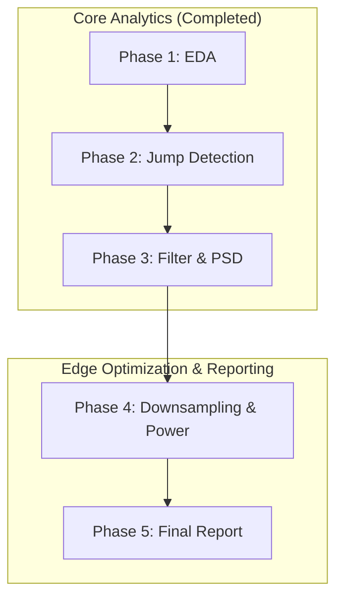

# Master Project Plan: Motocross Jump Analytics & Signal Processing Engine

This master plan outlines the staged roadmap to address all objectives specified in the **Motocross Jump Analytics & Powertrain Vibration Attenuation** problem statement. Work will proceed in sequential, verifiable steps.

---

## High-Level Execution Roadmap

---

## Phase Breakdown

### Phase 1: Exploratory Data Analysis (EDA)
- **Status**: COMPLETED (including Engine Noise Ingress EDA)
- **Detailed Specification**: Documented in [`eda_plan.md`](eda_plan.md) and [`eda_summary.md`](../eda_summary.md).
- **Execution Scripts**: [`src/eda_sensor_telemetry.py`](../../src/eda_sensor_telemetry.py) & [`src/analyze_engine_vibration_polarization.py`](../../src/analyze_engine_vibration_polarization.py)
- **Delivered Summary**: Documented in [`eda_summary.md`](../eda_summary.md) (Sections 1 through 6).
- **Delivered Visualizations**: 8 publication-quality figures saved in [`plots/eda/`](../../plots/eda/) and [`plots/`](../../plots/).
- **Key Findings**:
  - Confirmed 500.00 Hz sampling rate (zero clock jitter).
  - Isolated and linearly interpolated the 0.400s (200-sample) sensor dropout at $t \in [23.000, 23.398]\,\text{s}$.
  - Verified sharp bimodal separation: Ground $a_z \approx 9.82\,\text{m/s}^2$ vs Airborne $a_z \approx 0.01\,\text{m/s}^2$.
  - Confirmed 5 distinct jumps with landing shocks reaching $18.0 - 18.7\,\text{m/s}^2$.
  - Characterized 2-stroke engine noise ingress: $58.11\,\text{Hz}$ fundamental (3,487 RPM) and $116.21\,\text{Hz}$ 2nd harmonic.
  - Demonstrated sagittal plane polarization ($56.7^\circ$ cylinder tilt, $r = 0.985$ between $a_x$ and $a_z$, minimal lateral $a_y$).
  - Confirmed gyroscope immunity (flat white noise floor, no engine spectral lines).
  - Observed 16 dB drop in engine vibration power during airborne flight.

### Phase 2: Objective 1 — Jump Detection Algorithm & Dynamics Profiling
- **Status**: COMPLETED
- **Detailed Specification**: Documented in [`phase2_plan.md`](phase2_plan.md).
- **Execution Script**: [`src/detect_jumps_and_airtime.py`](../../src/detect_jumps_and_airtime.py)
- **Interactive Jupyter Notebook**: [`notebooks/02_Jump_Detection.ipynb`](../../notebooks/02_Jump_Detection.ipynb)
- **Delivered Output Directory**: [`results/phase2_jump_detection/`](../../results/phase2_jump_detection/)
- **Delivered Summary**: Documented in [`results/phase2_jump_detection/phase2_summary.md`](../../results/phase2_jump_detection/phase2_summary.md).
- **Snipped Datasets**: 10 CSV files in [`results/phase2_jump_detection/snipped_jumps/`](../../results/phase2_jump_detection/snipped_jumps/) (in-flight and context-buffered).
- **Delivered Visualizations**: 8 publication-grade figures in [`results/phase2_jump_detection/plots/`](../../results/phase2_jump_detection/plots/) and mirrored to [`plots/objective1/`](../../plots/objective1/).
- **Key Results**:
  - Detected exactly 5 jumps with zero false positives across 71.65s of ground riding.
  - Total air time: $18.320\,\text{s}$ across 5 jumps ($2.744\,\text{s}$, $3.494\,\text{s}$, $3.694\,\text{s}$, $5.594\,\text{s}$, $2.794\,\text{s}$).
  - Universal landing shock delay: peak deceleration impact occurs exactly $+18.0\,\text{ms}$ (9 samples) after initial ground contact.
  - Computed full statistical distribution properties of jump dynamics across all channels.
  - Validated pitch rotation: integrated pitch ranges from $29.6^\circ$ to $395.7^\circ$.

### Phase 3: Objective 2 — Spectral Analysis & Filter Design
- **Status**: COMPLETED
- **Detailed Specification**: Documented in [`phase3_plan.md`](phase3_plan.md).
- **Execution Script**: [`src/design_butterworth_filter_and_psd.py`](../../src/design_butterworth_filter_and_psd.py)
- **Interactive Jupyter Notebook**: [`notebooks/03_Filter_and_PSD.ipynb`](../../notebooks/03_Filter_and_PSD.ipynb)
- **Delivered Output Directory**: [`results/phase3_filter_design/`](../../results/phase3_filter_design/)
- **Delivered Summary**: Documented in [`results/phase3_filter_design/phase3_summary.md`](../../results/phase3_filter_design/phase3_summary.md).
- **Delivered Metrics**: [`results/phase3_filter_design/ground_psd_peaks.csv`](../../results/phase3_filter_design/ground_psd_peaks.csv) & [`results/phase3_filter_design/filter_specs.json`](../../results/phase3_filter_design/filter_specs.json).
- **Delivered Visualizations**: 6 publication-grade figures in [`results/phase3_filter_design/plots/`](../../results/phase3_filter_design/plots/) and mirrored to [`plots/objective2/`](../../plots/objective2/).
- **Key Results**:
  - Isolated clean ground segment $t \in [11.000, 17.000]\,\text{s}$ ($N = 3,001\,\text{samples}$).
  - Detected exact 2-stroke engine peaks: fundamental $f_1 = 58.11\,\text{Hz}$ ($-21.11\,\text{dB/Hz}$ on $a_z$, $-24.85\,\text{dB/Hz}$ on $a_x$) and 2nd harmonic $f_2 = 116.21\,\text{Hz}$ ($-27.83\,\text{dB/Hz}$ on $a_z$, $-31.44\,\text{dB/Hz}$ on $a_x$).
  - Provided rigorous physical justification: reciprocating piston unbalance couples into sagittal plane ($x-z$), while chassis torsional stiffness and MEMS Coriolis synchronous demodulation confer complete immunity to gyroscopes (noise floor $-65.3\,\text{dB/Hz}$).
  - Mathematically derived minimum filter order $N = 4$ for Butterworth low-pass ($f_c = 25.0\,\text{Hz}$) satisfying $A(20\,\text{Hz}) \le 1.0\,\text{dB}$ and $A(58\,\text{Hz}) \ge 30.0\,\text{dB}$.
  - Synthesized discrete transfer function via Bilinear Transform into 2 Second-Order Sections (Biquads / SOS) with zero DC gain error ($1.00000000$).
  - Implemented and benchmarked dual-mode filtering: Causal Direct Form II Transposed ($\tau_g \approx 18-24\,\text{ms}$, edge latency $16.0\,\text{ms}$) vs Zero-Phase forward-backward (`filtfilt`, $\tau_g = 0\,\text{ms}$, $\Delta\phi = 0^\circ$).
  - Proved spectral eradication: $58.11\,\text{Hz}$ suppressed by $30.54\,\text{dB}$ (causal) and $61.09\,\text{dB}$ (zero-phase), with $0.00\,\text{dB}$ distortion in the $0-10\,\text{Hz}$ motion band.

### Phase 4: Objective 3 — Downsampling & Power Efficiency
- **Status**: COMPLETED
- **Detailed Specification**: Documented in [`phase4_plan.md`](phase4_plan.md).
- **Execution Script**: [`src/downsample_sweep_and_aaf_analysis.py`](../../src/downsample_sweep_and_aaf_analysis.py)
- **Interactive Jupyter Notebook**: [`notebooks/04_Downsampling.ipynb`](../../notebooks/04_Downsampling.ipynb)
- **Delivered Output Directory**: [`results/phase4_downsampling/`](../../results/phase4_downsampling/)
- **Delivered Reports**: [`phase4_report.md`](../phase4_report.md), [`phase4_report.html`](../phase4_report.html), and [`results/phase4_downsampling/phase4_summary.md`](../../results/phase4_downsampling/phase4_summary.md).
- **Delivered Metrics**: [`results/phase4_downsampling/downsampling_sweep_metrics.csv`](../../results/phase4_downsampling/downsampling_sweep_metrics.csv) & [`results/phase4_downsampling/power_sampling_tradeoffs.json`](../../results/phase4_downsampling/power_sampling_tradeoffs.json).
- **Delivered Visualizations**: 6 publication-grade figures in [`results/phase4_downsampling/plots/`](../../results/phase4_downsampling/plots/) and mirrored to [`plots/objective3/`](../../plots/objective3/).
- **Key Findings & Engineering Mandates Answered**:
  - **Lowest Sampling Rate Identified**:
    - **Kinematic Free-Fall State Machine Bound**: **$1.0\,\text{Hz}$** ($M = 500$, $\Delta t = 1.0\,\text{s}$) achieves $100\%$ precision and recall ($F_1 = 1.000$) with zero false alarms. Mathematical boundary why $0.5\,\text{Hz}$ fails: shortest jump ($2.744\,\text{s}$) has only 1 sample, violating the $K \ge 2$ multi-sample validation requirement ($f_{s,\text{theor}} = 2 / 2.744 \approx 0.73\,\text{Hz}$).
    - **High-Precision Dynamics & Landing Shock Confirmation Bound**: **$20.0\,\text{Hz} - 50.0\,\text{Hz}$**. Below $25\,\text{Hz}$, the sample interval exceeds the suspension bottoming transient ($\tau_{\text{impulse}} \approx 20-30\,\text{ms}$), causing captured shock deceleration to attenuate from $18.24\,\text{m/s}^2$ to $<10\,\text{m/s}^2$ due to temporal impulse smearing.
  - **Anti-Aliasing Filter (AAF) Verdict**: **Mandatory for all rates $f_s \le 100\,\text{Hz}$**. Without AAF, $58.11\,\text{Hz}$ engine vibration folds to $8.11\,\text{Hz}$ at $50\,\text{Hz}$ (rider heave resonance) and to $1.89\,\text{Hz}$ at $20\,\text{Hz}$ (catastrophic corruption of gravity tilt and lean angles). AAF pre-filtering eradicates these foldover tones ($>30\,\text{dB}$ to $>70\,\text{dB}$ suppression).
  - **Battery Longevity Optimization**: On a $250\,\text{mAh}$ battery, downsampling from $500\,\text{Hz}$ to $50\,\text{Hz}$ extends operating runtime from **$10.1\,\text{days}$ to $87.4\,\text{days}$** ($>8.6\times$ extension), and to **$178.2\,\text{days}$ at $20\,\text{Hz}$** ($>17.6\times$ extension).
  - **Hardware Architecture Recommendation**: 2nd-order analog Sallen-Key low-pass filter ($f_c \approx 40\,\text{Hz}$) on the AFE combined with on-chip MEMS digital decimation (CIC / FIR filters) before transmission to host MCU.

### Phase 5: Professional Technical Report & Code Deliverables
- **Status**: COMPLETED (Detailed plan: [`final_report_plan.md`](final_report_plan.md))
- **Core Activities**:
  - Compile strictly-scoped, publication-grade markdown report [`final_report.md`](../final_report.md) responding directly to [`Motocross Jump Analytics & Powertrain Vibration Attenuation.pdf`](../specifications/MAE%20Task%20-%20Motocross%20Jump%20Analytics.pdf).
  - Deliver clean, modular Python codebase [`src/jump_analytics_pipeline.py`](../../src/jump_analytics_pipeline.py).
  - Deliver 4 core Jupyter notebooks:
    - [`notebooks/01_EDA.ipynb`](../../notebooks/01_EDA.ipynb) (Data inspection & dropout interpolation)
    - [`notebooks/02_Jump_Detection.ipynb`](../../notebooks/02_Jump_Detection.ipynb) (Objective 1: Jump Detection)
    - [`notebooks/03_Filter_and_PSD.ipynb`](../../notebooks/03_Filter_and_PSD.ipynb) (Objective 2: Filter Design & PSD)
    - [`notebooks/04_Downsampling.ipynb`](../../notebooks/04_Downsampling.ipynb) (Objective 3: Downsampling & AAF)
  - Deliver extended research notebooks:
    - [`notebooks/Filter_and_PSD_extended.ipynb`](../../notebooks/Filter_and_PSD_extended.ipynb) (SysID, Kalman/Complementary filters, SOS latency)
    - [`notebooks/EDA_and_Downsampling_extended.ipynb`](../../notebooks/EDA_and_Downsampling_extended.ipynb) (3D polarization, battery model, shock smearing)
  - Generate standalone HTML report ([`final_report.html`](../final_report.html)) with embedded high-resolution figures.

