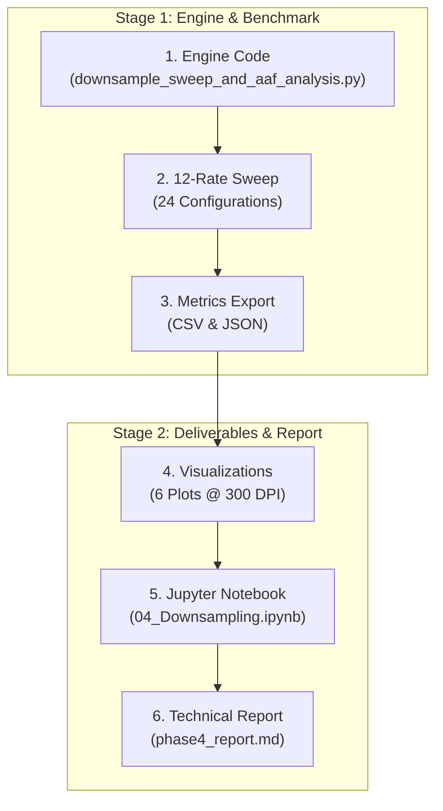

# Phase 4 Plan: Objective 3 — Downsampling & Power Efficiency Analysis

**Project**: Motocross Jump Analytics & Signal Processing Engine  
**Author**: Sachin Sagar (Edge IMU Motion Analytics Engine)  
**Dataset**: `data/motocross_imu_telemetry.csv` ($f_s = 500.00\,\text{Hz}$, $N = 45{,}000\,\text{samples}$, $T = 90.00\,\text{s}$)  
**Target Specification**: Objective 3 (Downsampling for Power Efficiency)  
**Deliverable Directory**: `results/phase4_downsampling/`

---

## 1. Executive Summary & Objective Mandates

In wearable sports electronics and frame-mounted IoT telemetry units (e.g., smart motorcycle systems), battery capacity is severely constrained by form factor and weight (typically $150 - 300\,\text{mAh}$). Continuous sampling at $500\,\text{Hz}$ incurs non-trivial power draw:
1. Continuous high-rate analog-to-digital conversions within the MEMS IMU.
2. High-frequency SPI/I2C bus transactions and DMA transfers.
3. Microcontroller (MCU) core wake cycles preventing low-power sleep modes.

**Objective 3 Mandates**:
1. **Downsample the dataset** across a systematic frequency grid to identify the **lowest sampling rate** at which all 5 jumps can still be correctly detected with zero false alarms.
2. Provide rigorous mathematical, physical, and signal-processing explanations for why jump detection succeeds or fails at specific sampling rates.
3. **Analyze Anti-Aliasing Filter (AAF) Requirements**:
   - Provide an in-depth analytical and empirical investigation of spectral aliasing when downsampling raw telemetry containing the $58.11\,\text{Hz}$ and $116.21\,\text{Hz}$ engine vibration spikes.
   - Contrast **Naive Decimation (Subsampling without AAF)** against **Bandlimited Decimation (with proper AAF)**.
   - Formulate concrete hardware and firmware recommendations for analog front-ends and on-chip digital decimation filters.

---

## 2. Mathematical Framework & Theoretical Foundations

### 2.1 The Shannon-Nyquist Theorem vs Event Detection Limits
- **Continuous Signal Reconstruction**:
  The Shannon-Nyquist criterion dictates:
  $$f_s > 2 f_{\max}$$
  For motocross chassis kinematics ($f_{\max} \approx 20\,\text{Hz}$), waveform reconstruction requires $f_s > 40\,\text{Hz}$.
- **Kinematic Event Detection (Free-Fall Threshold Crossing)**:
  Unlike continuous waveform reconstruction, jump detection is a **finite-state machine threshold-crossing problem**:
  $$\text{Airborne State} \iff \| \mathbf{a}(t) \| < \tau_{\text{threshold}} \quad \text{for duration } \Delta t \ge T_{\text{min\_air}}$$
  The empirical minimum jump duration in the session is $T_{\text{air, min}} = 2.744\,\text{s}$ (Jump 1).
  In an idealized noiseless signal, detecting at least $K$ samples during free fall requires:
  $$f_s \ge \frac{K}{T_{\text{air, min}}}$$
  For $K = 2$ samples, the theoretical lower bound is:
  $$f_{s, \text{theoretical}} = \frac{2}{2.744} \approx \mathbf{0.73\,\text{Hz}}$$
  However, real-world signals are corrupted by engine vibration, noise spikes, and boundary transitions. Phase 4 will empirically establish the **practical lower bound** ($f_{s, \text{practical}}$) and evaluate the performance degradation across intermediate rates.

### 2.2 Spectral Aliasing & The Nyquist Folding Formula
When a continuous signal with frequency component $f_0$ is sampled or decimated to a new sampling frequency $f_{s,\text{new}}$ without low-pass filtering, high-frequency energy folds into the baseband $[0, f_{s,\text{new}}/2]$ according to:
$$f_{\text{alias}} = \left| f_0 - k \cdot f_{s,\text{new}} \right|, \quad k = \operatorname{round}\left(\frac{f_0}{f_{s,\text{new}}}\right)$$

#### Folding Trajectory of Motocross Engine Harmonics:
We specifically track the $f_1 = 58.11\,\text{Hz}$ fundamental and $f_2 = 116.21\,\text{Hz}$ harmonic across candidate sampling rates:
- **$f_s = 250\,\text{Hz}$** ($f_{\text{Nyq}} = 125\,\text{Hz}$): No aliasing ($58.11\,\text{Hz} < 125\,\text{Hz}$, $116.21\,\text{Hz} < 125\,\text{Hz}$).
- **$f_s = 100\,\text{Hz}$** ($f_{\text{Nyq}} = 50\,\text{Hz}$):
  - $f_1 = 58.11\,\text{Hz} \implies f_{\text{alias}} = |58.11 - 100| = \mathbf{41.89\,\text{Hz}}$ (remains outside the $0-20\,\text{Hz}$ motion band).
  - $f_2 = 116.21\,\text{Hz} \implies f_{\text{alias}} = |116.21 - 100| = \mathbf{16.21\,\text{Hz}}$ (**folds directly into the motocross steering/posture band!**).
- **$f_s = 50\,\text{Hz}$** ($f_{\text{Nyq}} = 25\,\text{Hz}$):
  - $f_1 = 58.11\,\text{Hz} \implies f_{\text{alias}} = |58.11 - 50| = \mathbf{8.11\,\text{Hz}}$ (**folds directly into human body suspension/heave motion!**).
  - $f_2 = 116.21\,\text{Hz} \implies f_{\text{alias}} = |116.21 - 2 \times 50| = \mathbf{16.21\,\text{Hz}}$ (**folds into chassis pitching band!**).
- **$f_s = 20\,\text{Hz}$** ($f_{\text{Nyq}} = 10\,\text{Hz}$):
  - $f_1 = 58.11\,\text{Hz} \implies f_{\text{alias}} = |58.11 - 3 \times 20| = \mathbf{1.89\,\text{Hz}}$ (**folds into DC gravity/terrain tilt band!**).
  - $f_2 = 116.21\,\text{Hz} \implies f_{\text{alias}} = |116.21 - 6 \times 20| = \mathbf{3.79\,\text{Hz}}$ (**severe corruption of baseline acceleration!**).

This proves that without an anti-aliasing filter, engine vibration folds into the $1 - 10\,\text{Hz}$ band, corrupting airborne free-fall detection and creating false triggers.

---

## 3. Systematic Experimental Methodology

### 3.1 Candidate Sampling Rate Grid
We evaluate 12 discrete sampling frequencies spanning 3 orders of magnitude:

| Rate Index | Sampling Rate ($f_s$) | Decimation Factor ($M$) | Sample Interval ($\Delta t$) | Nyquist Limit ($f_{\text{Nyq}}$) | Practical Purpose |
| :---: | :---: | :---: | :---: | :---: | :--- |
| 1 | **$500.0\,\text{Hz}$** | $M = 1$ | $2.0\,\text{ms}$ | $250.0\,\text{Hz}$ | Native IMU Baseline (Ground Truth) |
| 2 | **$250.0\,\text{Hz}$** | $M = 2$ | $4.0\,\text{ms}$ | $125.0\,\text{Hz}$ | High-fidelity sports telemetry |
| 3 | **$125.0\,\text{Hz}$** | $M = 4$ | $8.0\,\text{ms}$ | $62.5\,\text{Hz}$ | Commercial action camera IMU rate |
| 4 | **$100.0\,\text{Hz}$** | $M = 5$ | $10.0\,\text{ms}$ | $50.0\,\text{Hz}$ | Standard BLE telemetry rate |
| 5 | **$50.0\,\text{Hz}$** | $M = 10$ | $20.0\,\text{ms}$ | $25.0\,\text{Hz}$ | Standard wearable sports watch rate |
| 6 | **$25.0\,\text{Hz}$** | $M = 20$ | $40.0\,\text{ms}$ | $12.5\,\text{Hz}$ | Low-power tracking mode |
| 7 | **$20.0\,\text{Hz}$** | $M = 25$ | $50.0\,\text{ms}$ | $10.0\,\text{Hz}$ | Minimal kinematic motion tracking |
| 8 | **$10.0\,\text{Hz}$** | $M = 50$ | $100.0\,\text{ms}$ | $5.0\,\text{Hz}$ | GPS-synchronous rate |
| 9 | **$5.0\,\text{Hz}$** | $M = 100$ | $200.0\,\text{ms}$ | $2.5\,\text{Hz}$ | Ultra-low power IoT beacon rate |
| 10 | **$2.0\,\text{Hz}$** | $M = 250$ | $500.0\,\text{ms}$ | $1.0\,\text{Hz}$ | Coarse activity classification |
| 11 | **$1.0\,\text{Hz}$** | $M = 500$ | $1000.0\,\text{ms}$ | $0.5\,\text{Hz}$ | Extreme heartbeat monitoring |
| 12 | **$0.5\,\text{Hz}$** | $M = 1000$ | $2000.0\,\text{ms}$ | $0.25\,\text{Hz}$ | Theoretical boundary check |

### 3.2 Dual Downsampling Pipelines (AAF vs Non-AAF)
For every rate $f_{s,\text{target}} = \frac{500}{M}$, two parallel datasets will be generated:
1. **Pipeline A: Naive Decimation (No AAF)**:
   $$x_{\text{naive}}[k] = x[k \cdot M], \quad k = 0, 1, \dots, \lfloor N/M \rfloor - 1$$
   - Emulates hardware without analog front-end low-pass filters or software decimation without pre-filtering.
2. **Pipeline B: Anti-Aliased Decimation (With AAF)**:
   $$x_{\text{aaf}}[n] = H_{\text{AAF}}(z) * x[n], \quad x_{\text{down}}[k] = x_{\text{aaf}}[k \cdot M]$$
   - $H_{\text{AAF}}(z)$ is an 8th-order Chebyshev Type I or Butterworth low-pass digital filter designed with cutoff:
     $$f_{\text{cutoff}} = 0.4 \times f_{s,\text{target}} = 0.8 \times f_{\text{Nyq}}$$
     providing $\ge 40\,\text{dB}$ stopband rejection at $f_{\text{Nyq}}$ to ensure zero spectral foldover.

### 3.3 Quantitative Performance Benchmark Metrics
At each sampling rate and for both pipelines, the robust Jump Detector (from Phase 2) will be executed, and the following metrics logged:
1. **Jump Detection Success Rate**:
   - Total detected jumps ($N_{\text{detected}}$ out of 5).
   - False Positives ($N_{\text{FP}}$) during 71.65 seconds of ground riding.
   - False Negatives ($N_{\text{FN}}$).
   - $F_1$-score and Precision/Recall.
2. **Timing & Air-Time Accuracy**:
   - Takeoff timestamp error: $\Delta t_{\text{takeoff}} = |t_{\text{to, down}} - t_{\text{to, 500Hz}}|$.
   - Landing timestamp error: $\Delta t_{\text{landing}} = |t_{\text{land, down}} - t_{\text{land, 500Hz}}|$.
   - Air-time absolute error ($e_{\text{air}} = |\Delta t_{\text{air, down}} - \Delta t_{\text{air, 500Hz}}|$) and relative percentage error.
3. **Landing Impact Shock Retention**:
   - Measured peak landing deceleration ($a_{z, \text{peak}}$) compared to the $18.0 - 18.7\,\text{m/s}^2$ ground truth.
   - Characterization of impact impulse smearing due to sample interval $\Delta t$.
4. **Power Consumption & Battery Life Estimation**:
   - Power model parameterized from real-world 6-axis MEMS IMU datasheets (Bosch BMI270 / TDK ICM-42688):
     $$I_{\text{IMU}}(f_s) = I_{\text{base}} + \alpha \cdot f_s$$
     $$I_{\text{MCU\_active}} = 3.5\,\text{mA}, \quad I_{\text{MCU\_sleep}} = 15\,\mu\text{A}$$
     $$\text{Duty Cycle } D(f_s) = \frac{t_{\text{read}} \cdot f_s}{1.0\,\text{s}}$$
     $$I_{\text{total\_avg}}(f_s) = I_{\text{IMU}}(f_s) + D(f_s) I_{\text{MCU\_active}} + (1 - D(f_s)) I_{\text{MCU\_sleep}}$$
     $$\text{Battery Life [hours]} = \frac{\text{Capacity } [250\,\text{mAh}]}{I_{\text{total\_avg}}(f_s)}$$
   - Formulate Pareto-optimal trade-off frontiers between Battery Life and Timing Precision.

---

## 4. Planned High-Resolution Visualizations

We will generate 6 publication-grade figures in `results/phase4_downsampling/plots/` and `plots/objective3/`:

1. **Figure 1: Detection Success & Air-Time Accuracy vs Sampling Rate (Pareto Frontier)**:
   - Top: Jump detection count ($0 - 5$) and false positive count as a function of sampling frequency.
   - Bottom: Mean absolute air-time error ($\text{ms}$) with error bars across all 5 jumps.
2. **Figure 2: Spectral Aliasing & Harmonic Folding Mechanism**:
   - Welch PSD comparison of raw ground data vs downsampled data at $100\,\text{Hz}$, $50\,\text{Hz}$, and $20\,\text{Hz}$, showing exact foldback of $58.11\,\text{Hz}$ and $116.21\,\text{Hz}$ into $8.11\,\text{Hz}$ and $1.89\,\text{Hz}$.
3. **Figure 3: Anti-Aliased vs Naive Decimation Telemetry Overlay**:
   - Time-domain comparisons during Jump 1 ($t \in [6.5, 10.5]\,\text{s}$) across $500\,\text{Hz}$, $50\,\text{Hz}$, $20\,\text{Hz}$, $10\,\text{Hz}$, and $2\,\text{Hz}$, contrasting signals with and without AAF.
4. **Figure 4: Takeoff & Landing Timing Quantization Error Distributions**:
   - Error bar / box plot showing how sample period $\Delta t$ bounds maximum edge timing uncertainty ($\pm \frac{\Delta t}{2}$).
5. **Figure 5: Landing Shock Impulse Peak Attenuation**:
   - Analysis of landing deceleration peak capture ($18\,\text{m/s}^2 \to 12\,\text{m/s}^2 \to 5\,\text{m/s}^2$) as sample duration exceeds the $18\,\text{ms}$ suspension compression transient.
6. **Figure 6: Energy Efficiency & Battery Life Trade-Off Curve**:
   - Battery operational lifetime (hours / days) vs sampling rate, highlighting the "sweet-spot" operational point.

---

## 5. Execution Roadmap & Staged Implementation Steps

### Detailed Staging:
- **Stage 4.1**: Create `src/downsample_sweep_and_aaf_analysis.py` implementing both decimation pipelines, automated jump detection across all rates, metric logging, and battery modeling.
- **Stage 4.2**: Execute the frequency sweep and generate:
  - `results/phase4_downsampling/downsampling_sweep_metrics.csv`
  - `results/phase4_downsampling/power_sampling_tradeoffs.json`
- **Stage 4.3**: Generate Figures 1 through 6, saving them into `results/phase4_downsampling/plots/`, `plots/objective3/`, and brain artifact `plots/`.
- **Stage 4.4**: Build `notebooks/04_Downsampling.ipynb` with interactive widgets, downsampling sliders, and spectral displays.
- **Stage 4.5**: Author `phase4_report.md` with full theoretical explanations, empirical findings, hardware/firmware anti-aliasing recommendations, and validated Markdown tables.
- **Stage 4.6**: Generate standalone HTML reports (`phase4_report.html` and `results/phase4_downsampling/report.html`) with MathJax rendering.
- **Stage 4.7**: Update `master_plan.md` and `walkthrough.md`.

---

## 6. Deliverables Checklist for Phase 4

- [ ] [`src/downsample_sweep_and_aaf_analysis.py`](../../src/downsample_sweep_and_aaf_analysis.py): Pure NumPy downsampling, decimation, and power modeling pipeline.
- [ ] [`results/phase4_downsampling/downsampling_sweep_metrics.csv`](../../results/phase4_downsampling/downsampling_sweep_metrics.csv): Comprehensive metrics table across 24 test conditions.
- [ ] [`results/phase4_downsampling/power_sampling_tradeoffs.json`](../../results/phase4_downsampling/power_sampling_tradeoffs.json): Machine-readable power, battery life, and error specifications.
- [ ] 6 Publication-grade figures in [`results/phase4_downsampling/plots/`](../../results/phase4_downsampling/plots/) and [`plots/objective3/`](../../plots/objective3/).
- [ ] [`notebooks/04_Downsampling.ipynb`](../../notebooks/04_Downsampling.ipynb): Interactive, runnable Jupyter notebook.
- [ ] [`phase4_report.md`](../phase4_report.md): Full technical engineering report with relative root links and validated tables.
- [ ] [`phase4_report.html`](../phase4_report.html): Complete standalone HTML report with MathJax rendering.
- [ ] Updated [`master_plan.md`](master_plan.md) and [`walkthrough.md`](../walkthrough.md).

