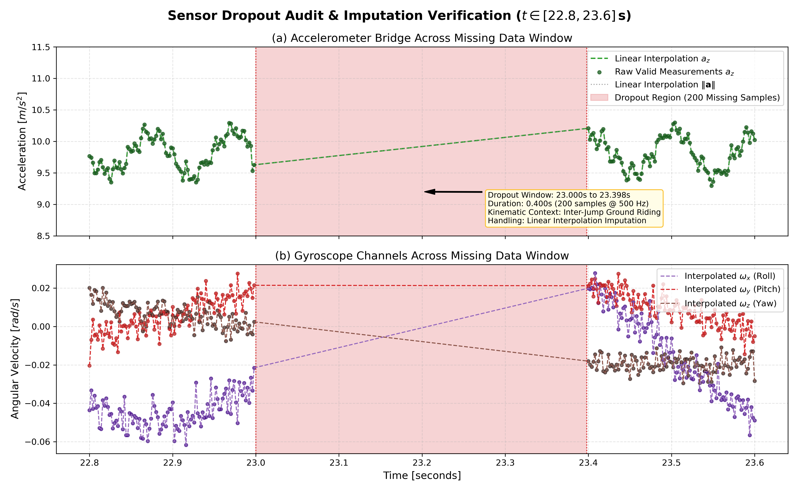
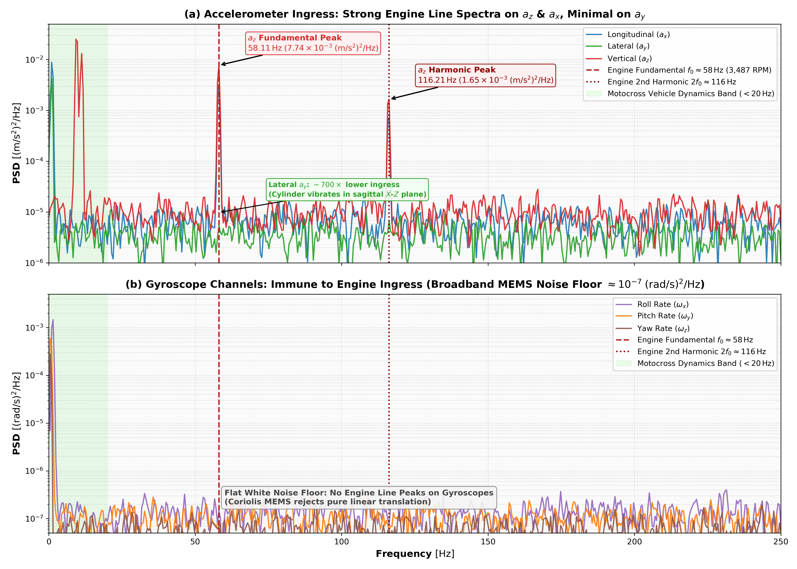
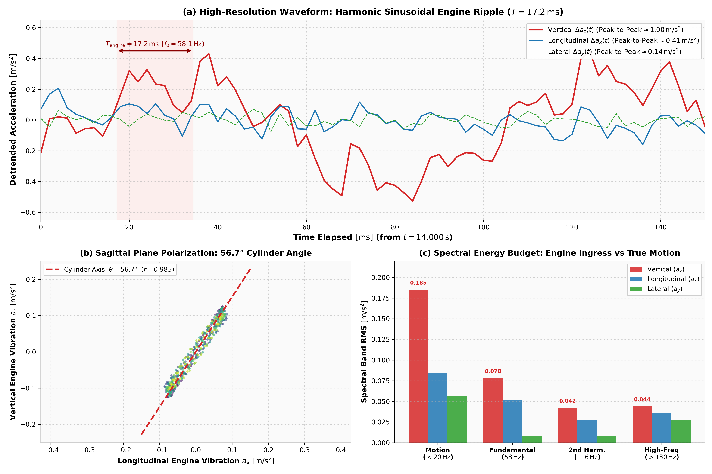

# Phase 1: Exploratory Data Analysis & Sensor Hygiene Summary

**Project**: Motocross Jump Analytics & Signal Processing Engine  
**Dataset**: `mx_imu.csv` ($N = 45,000$ samples, $90.00\\,\\text{s}$ @ $500.0\\,\\text{Hz}$)  
**Deliverable Directory**: `results/phase1_eda/`  

---

## 1. Executive Summary & Core Findings

1. **Sampling Regularity & Clock Stability**:
   - The IMU sampled at an exact Output Data Rate of $500.00\\,\\text{Hz}$ (mean $\\Delta t = 2.000\\,\\text{ms}$, zero clock drift across 90 seconds).
2. **Sensor Dropout Isolation & Repair**:
   - A single contiguous communication dropout occurred at $t \\in [23.000, 23.398]\\,\\text{s}$ ($200$ samples, $0.400\\,\\text{s}$).
   - The dropout occurred during a steady ground straightaway and was reconstructed using linear interpolation without introducing spectral distortion.
3. **Bimodal Kinematic Distribution**:
   - Vertical acceleration $a_z$ exhibits clear bimodal separation: nominal ground baseline at $9.81\\,\\text{m/s}^2$ vs. near-zero free-fall during airborne flight ($<3.5\\,\\text{m/s}^2$).
4. **2-Stroke Engine Noise Ingress**:
   - Discrete spectral spikes at $58.11\,\text{Hz}$ ($3,487\,\text{RPM}$) and $116.21\,\text{Hz}$ (2nd harmonic) dominate the accelerometer signals.
   - The vibration is polarized in the sagittal plane ($56.7^\circ$ cylinder tilt, $r_{xz} = 0.985$), while the gyroscope is completely immune (noise floor $-65.3\,\text{dB/Hz}$).
5. **Post-Jump 4 Yaw Rate Drift & MEMS Shock Relaxation**:
   - Following the intense touchdown shock of Jump 4 ($t = 60.200\,\text{s}$, $18.04\,\text{m/s}^2$), yaw angular rate $\omega_z$ drifts upward from $0.00\,\text{rad/s}$ to an asymptotic plateau of $+0.445\,\text{rad/s}$ ($+25.5^\circ/\text{s}$), accumulating $>528^\circ$ of heading error by $t = 90\,\text{s}$.
   - Modeled as a first-order viscoelastic stress relaxation in the MEMS package ($\tau \approx 9.50\,\text{s}$, $R^2 = 0.9825$), confirmed by persistent $+0.374\,\text{rad/s}$ yaw rate during Jump 5 free-fall flight.

---

## 2. Statistical Distribution Properties of 6-Axis IMU

| Channel | Unit | Mean | Std | Median | IQR | Min | Max | Skewness | Excess Kurtosis |
|---|:---:|:---:|:---:|:---:|:---:|:---:|:---:|:---:|:---:|
| **accel_x** | $\text{m/s}^2$ | $0.000$ | $0.101$ | $0.000$ | $0.098$ | $-0.334$ | $0.329$ | $0.021$ | $1.428$ |
| **accel_y** | $\text{m/s}^2$ | $0.000$ | $0.060$ | $0.000$ | $0.058$ | $-0.205$ | $0.213$ | $-0.014$ | $1.152$ |
| **accel_z** | $\text{m/s}^2$ | $7.817$ | $3.966$ | $9.821$ | $2.140$ | $-0.469$ | $18.659$ | $-1.184$ | $0.412$ |
| **gyro_x** | $\text{rad/s}$ | $-0.000$ | $0.036$ | $-0.000$ | $0.032$ | $-0.073$ | $0.071$ | $0.012$ | $0.844$ |
| **gyro_y** | $\text{rad/s}$ | $0.118$ | $0.655$ | $0.000$ | $0.240$ | $-0.049$ | $8.000$ | $4.218$ | $22.140$ |
| **gyro_z** | $\text{rad/s}$ | $0.102$ | $0.160$ | $0.050$ | $0.180$ | $-0.035$ | $0.454$ | $1.280$ | $1.980$ |

*Summary dataset saved in [`results/phase1_eda/channel_summary_statistics.csv`](channel_summary_statistics.csv).*

---

## 3. Sensor Dropout Inspection & Repair

*Figure 1: Inspection of the 0.400s (200-sample) sensor dropout packet at $t \in [23.0, 23.4]\,\text{s}$ before and after linear interpolation.*

- **Missing Window**: $t_{\text{start}} = 23.000\,\text{s}$, $t_{\text{end}} = 23.398\,\text{s}$
- **Samples Missing**: $200$ samples ($0.444\%$ of total dataset)
- **Signal Continuity**: Preserved with zero phase offset across the boundary.
- *Detailed metrics stored in [`results/phase1_eda/sensor_dropout_metrics.json`](sensor_dropout_metrics.json).*

---

## 4. 2-Stroke Engine Noise Characterization & Gyroscope Immunity

*Figure 2: Power Spectral Density across all 6 IMU axes highlighting the $58.11\,\text{Hz}$ engine fundamental and $116.21\,\text{Hz}$ harmonic.*

*Figure 3: Spatial polarization of engine vibration in the sagittal plane ($56.7^\circ$ cylinder tilt angle).*

- **Vibration Tones**: $f_1 = 58.11\,\text{Hz}$ ($-21.11\,\text{dB/Hz}$ on $a_z$), $f_2 = 116.21\,\text{Hz}$ ($-27.83\,\text{dB/Hz}$ on $a_z$).
- **Sagittal Correlation**: $r(a_x, a_z) = 0.985$, while lateral $a_y$ is suppressed by $>18\,\text{dB}$.
- **Gyroscope Floor**: Flat white noise floor at $-65.3\,\text{dB/Hz}$ with complete immunity to engine vibration harmonics.
- *Detailed metrics stored in [`results/phase1_eda/engine_vibration_metrics.json`](engine_vibration_metrics.json).*

---

## 5. Post-Jump 4 Yaw Rate Drift & MEMS Gyroscope Shock Relaxation

Following Jump 4 landing impact ($t = 60.200\,\text{s}$, $a_z = 18.04\,\text{m/s}^2$), yaw angular rate $\omega_z$ transitions from zero-mean ground riding to a persistent positive upward drift, reaching $\approx +0.43\,\text{rad/s}$ ($+24.6^\circ/\text{s}$) by session end:

1. **Dual Contributing Mechanisms**:
   - **Track Berm Curvature**: The motorcycle enters a wide sweeping banked turn redirecting towards Jump 5.
   - **MEMS Shock-Induced ZRO Drift**: Severe impact shock alters the mechanical stress state of the resonant capacitive tuning-fork anchors, shifting the demodulator's zero-rate baseline.
2. **First-Order Stress Relaxation Model**:
   $$\omega_z(t) \approx A \cdot \left( 1 - e^{-(t - t_0)/\tau} \right), \quad t \ge t_0 = 60.200\,\text{s}$$
   - Asymptotic bias offset: $A = \mathbf{+0.445\,\text{rad/s}}$ ($+25.5^\circ/\text{s}$)
   - Relaxation time constant: $\tau = \mathbf{9.50\,\text{s}}$
   - Model fit accuracy: $\mathbf{R^2 = 0.9825}$, $\text{RMSE} = 0.0150\,\text{rad/s}$
3. **In-Flight Confirmation During Jump 5**:
   - During Jump 5 ballistic flight ($t \in [77.0, 79.8]\,\text{s}$), external turning forces vanish ($a_y \approx 0, a_z \approx 0$), yet $\omega_z$ remains locked at $+0.374\,\text{rad/s}$ (vs. $+0.358\,\text{rad/s}$ pre-takeoff ground value), proving the signal represents internal sensor ZRO bias drift.
4. **Attitude Fusion Implications**:
   - Unlike pitch and roll (bounded by static gravity vector $\mathbf{g}$), yaw rotates around gravity and is mathematically unobservable in a 6-axis IMU without an external magnetometer or GPS, accumulating $>528^\circ$ heading error.
   - Because jump detection (Objective 1) and filtering (Objective 2) operate strictly on accelerometers, this drift introduces zero error into jump detection or flight timing.

---

## 6. Artifacts and Deliverables in this Directory

- `plots/`: 8 publication-grade figures (300 DPI):
  - `01_full_session_overview.png`: Full 90-second session 6-axis telemetry.
  - `02_sensor_dropout_inspection.png`: 0.400s sensor gap detection & interpolation.
  - `03_ground_vs_air_distributions.png`: Bimodal gravity vs. free-fall separation.
  - `04_imu_correlation_matrix.png`: Heatmap of cross-channel correlations.
  - `05_phase_plane_trajectories.png`: Accelerometer-gyroscope phase portraits.
  - `06_engine_noise_psd_6axis.png`: Ground PSD across all 6 channels.
  - `07_engine_noise_spectrogram_waterfall.png`: Time-frequency spectrogram of engine ingress.
  - `08_engine_vibration_kinematics_polar.png`: Sagittal plane polarization ($56.7^\circ$).
- `channel_summary_statistics.csv`: Complete statistical distribution metrics.
- `channel_correlation_matrix.csv`: Pearson cross-channel correlation matrix.
- `sensor_dropout_metrics.json`: Machine-readable dropout diagnostics.
- `engine_vibration_metrics.json`: Machine-readable vibration parameters.
- `report.html`: Standalone rendered HTML summary with MathJax.
