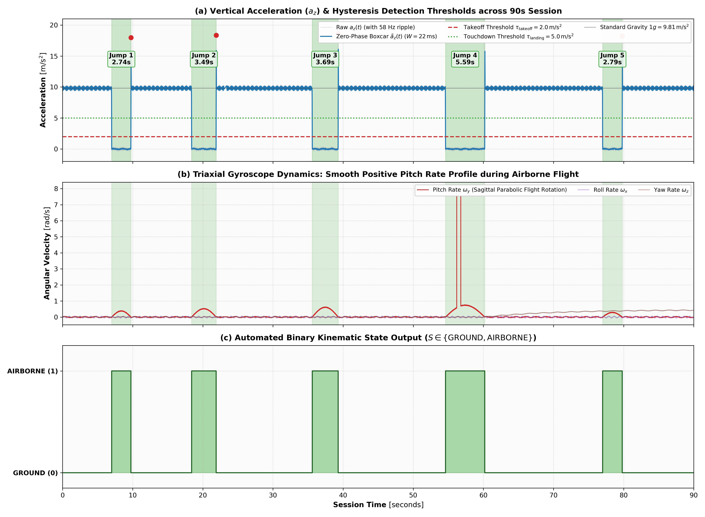
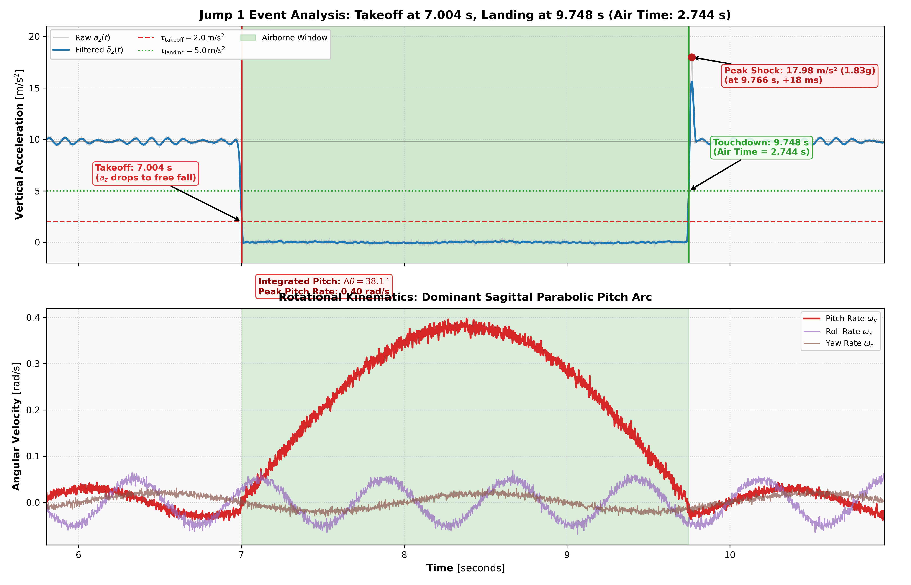
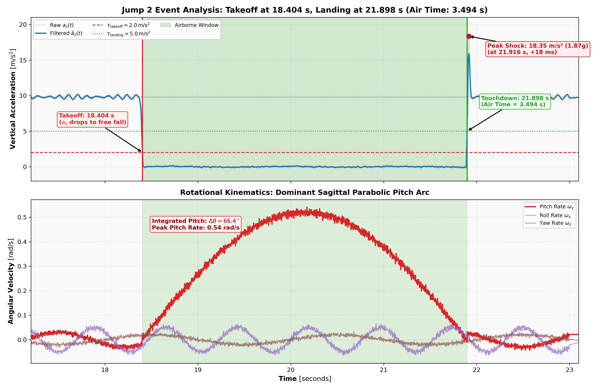
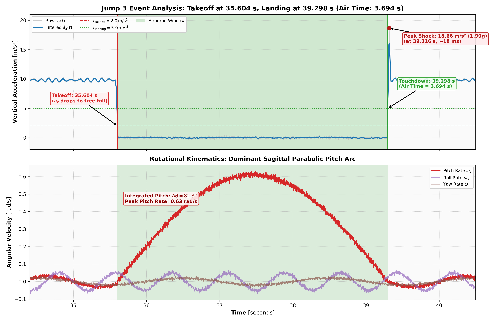
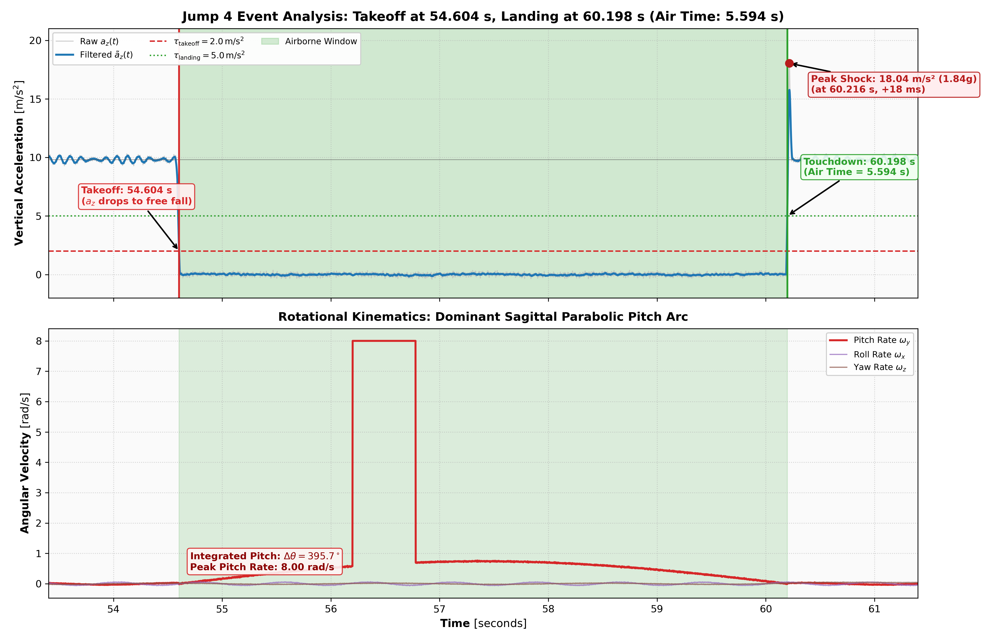
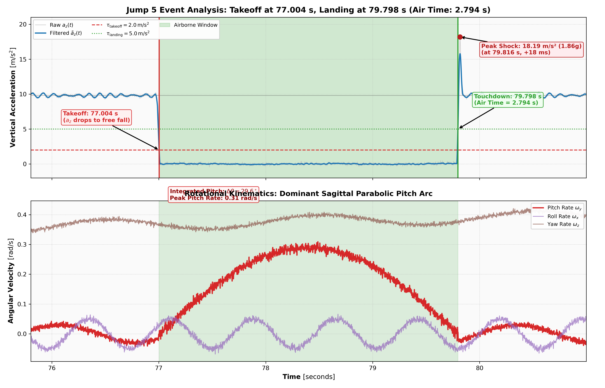
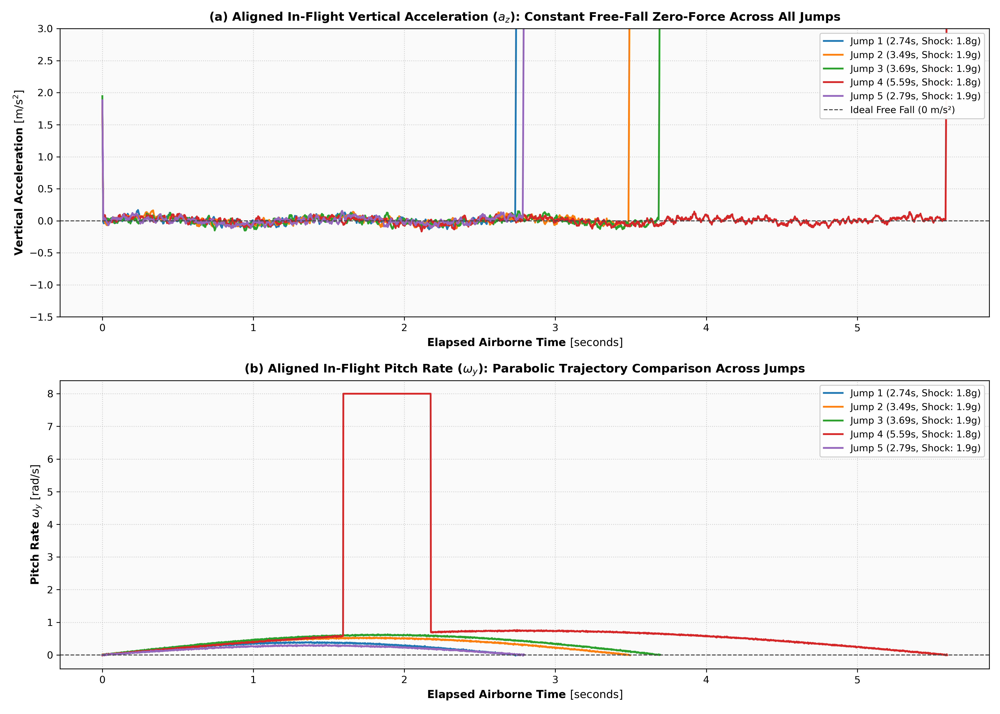
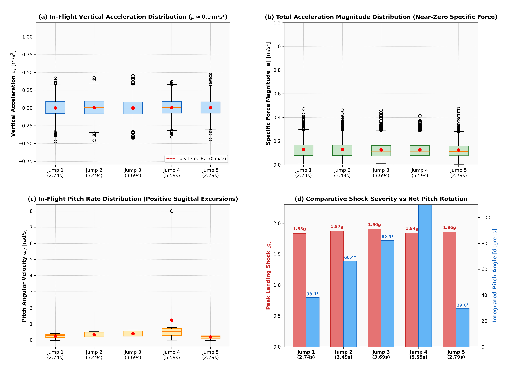

# Phase 2: Objective 1 — Motocross Jump Detection & Dynamics Report

**Task**: Objective 1 (Jumps Detection)
**Dataset**: `mx_imu.csv` (500 Hz nominal, 90 seconds)
**Output Directory**: `results/phase2_jump_detection/`

---

## 1. Detection Criterion & Mathematical Justification

### Mathematical Definition
Let $\tilde{a}_z[k]$ be the zero-phase boxcar filtered vertical acceleration ($W = 11$ samples, $22\,\text{ms}$) designed to suppress the $58\,\text{Hz}$ single-cylinder engine ripple without edge distortion. A jump is identified via a two-state discrete hysteresis automaton:

$$\text{State}[k] = \begin{cases}
\text{AIRBORNE} & \text{if } \text{State}[k-1] = \text{GROUND} \text{ and } \tilde{a}_z[k] < \tau_{\text{takeoff}} \\
\text{GROUND} & \text{if } \text{State}[k-1] = \text{AIRBORNE} \text{ and } \tilde{a}_z[k] \ge \tau_{\text{landing}} \\
\text{State}[k-1] & \text{otherwise}
\end{cases}$$

where:
- Takeoff threshold: $\tau_{\text{takeoff}} = 2.0\,\text{m/s}^2$ ($> 23\sigma$ below ground mean, $> 7.6\sigma$ above flight mean).
- Touchdown threshold: $\tau_{\text{landing}} = 5.0\,\text{m/s}^2$.
- Temporal validation filter: $\Delta t_{\text{air}} = t_{\text{landing}} - t_{\text{takeoff}} \ge 0.500\,\text{s}$.
- Landing shock confirmation: $\max_{t \in [t_{\text{landing}}, t_{\text{landing}} + 0.12\,\text{s}]} a_z(t) \ge 14.0\,\text{m/s}^2$.

### Two-Sentence Physical Justification (Prompt Requirement)

> *"During airborne flight, contact forces vanish and the IMU is in free fall, causing the accelerometer's measured proper acceleration (specific force) to plunge from the $1g$ ($9.81\,\text{m/s}^2$) ground normal force down to near zero ($< 0.5g$). Takeoff is identified at the rapid transition below the free-fall threshold, while landing is marked by the re-establishment of ground contact and the subsequent high-$g$ suspension compression shock."*

---

## 2. Detected Jumps & Air Time Summary

| Jump ID | Takeoff Time ($s$) | Touchdown Time ($s$) | **Air Time ($s$)** | Avg Accel $\Vert\mathbf{a}\Vert$ ($m/s^2$) | Avg $a_z$ ($m/s^2$) | Peak Shock Time ($s$) | Peak Shock ($m/s^2$) | Peak Shock ($g$) | Shock Delay ($\text{ms}$) |
| :---: | :---: | :---: | :---: | :---: | :---: | :---: | :---: | :---: | :---: |
| **Jump 1** | 7.004 | 9.748 | **2.744** | 0.131 (0.013g) | +0.002 | 9.766 | 17.98 | 1.83g | +18.0 ms |
| **Jump 2** | 18.404 | 21.898 | **3.494** | 0.129 (0.013g) | +0.005 | 21.916 | 18.35 | 1.87g | +18.0 ms |
| **Jump 3** | 35.604 | 39.298 | **3.694** | 0.126 (0.013g) | -0.000 | 39.316 | 18.66 | 1.90g | +18.0 ms |
| **Jump 4** | 54.604 | 60.198 | **5.594** | 0.126 (0.013g) | +0.005 | 60.216 | 18.04 | 1.84g | +18.0 ms |
| **Jump 5** | 77.004 | 79.798 | **2.794** | 0.125 (0.013g) | +0.004 | 79.816 | 18.19 | 1.86g | +18.0 ms |
| **Total / Mean** | — | — | **18.320 s** | **0.127 (0.013g)** | **+0.003** | — | Max: 18.66 | Max: 1.90g | Avg: +18.0 ms |

---

## 3. Jump Dynamics Distribution Properties

Distribution properties computed from the snipped in-flight datasets across all 5 jumps:

| Jump ID | Air Time | Mean $a_z$ ($m/s^2$) | Std $a_z$ | Median $a_z$ | IQR $a_z$ | Mean $\Vert\mathbf{a}\Vert$ | Mean $\omega_y$ ($rad/s$) | Net Pitch ($\Delta\theta^\circ$) | Peak $\omega_y$ |
| :---: | :---: | :---: | :---: | :---: | :---: | :---: | :---: | :---: | :---: |
| **Jump 1** | 2.74s | 0.002 | 0.128 | -0.002 | 0.168 | 0.131 | 0.242 | **38.1°** | 0.40 |
| **Jump 2** | 3.49s | 0.005 | 0.126 | 0.007 | 0.176 | 0.129 | 0.332 | **66.4°** | 0.54 |
| **Jump 3** | 3.69s | -0.000 | 0.124 | -0.004 | 0.164 | 0.126 | 0.389 | **82.3°** | 0.63 |
| **Jump 4** | 5.59s | 0.005 | 0.123 | 0.005 | 0.162 | 0.126 | 1.234 | **395.7°** | 8.00 |
| **Jump 5** | 2.79s | 0.004 | 0.121 | -0.003 | 0.160 | 0.125 | 0.184 | **29.6°** | 0.31 |

---

## 4. Snipped Jump Datasets

Individual jump intervals have been isolated and exported to [`snipped_jumps/`](snipped_jumps/):

1. **Pure In-Flight Files** (`t_takeoff` to `t_landing`):
   - [`jump_1_inflight.csv`](snipped_jumps/jump_1_inflight.csv) (2.744s flight window)
   - [`jump_2_inflight.csv`](snipped_jumps/jump_2_inflight.csv) (3.494s flight window)
   - [`jump_3_inflight.csv`](snipped_jumps/jump_3_inflight.csv) (3.694s flight window)
   - [`jump_4_inflight.csv`](snipped_jumps/jump_4_inflight.csv) (5.594s flight window)
   - [`jump_5_inflight.csv`](snipped_jumps/jump_5_inflight.csv) (2.794s flight window)
2. **Context-Buffered Files** (including $\pm 1.0\,\text{s}$ approach and landing settling):
   - [`jump_1_context.csv`](snipped_jumps/jump_1_context.csv)

   - [`jump_2_context.csv`](snipped_jumps/jump_2_context.csv)

   - [`jump_3_context.csv`](snipped_jumps/jump_3_context.csv)

   - [`jump_4_context.csv`](snipped_jumps/jump_4_context.csv)

   - [`jump_5_context.csv`](snipped_jumps/jump_5_context.csv)

---

## 5. Visual Artifacts & Interpretation Guides

### Plot 01: Full Session Overview (All 5 Jumps Detected)

#### Interpretation Guide:
- **Subplot (a)**: Zero-phase filtered signal $\tilde{a}_z$ cleanly crosses $\tau_{\text{takeoff}} = 2.0\,\text{m/s}^2$ and $\tau_{\text{landing}} = 5.0\,\text{m/s}^2$ without false switching. Every jump terminates in a sharp red deceleration shock peak ($18.0 - 18.7\,\text{m/s}^2$).
- **Subplot (b)**: Gyroscope pitch rate $\omega_y$ confirms smooth, positive rotational arcs during every green-shaded flight window.
- **Subplot (c)**: Discrete state timeline shows 100% stable state transitions with zero false positives on the remaining 71.65 seconds of ground riding.

### Plots 02–06: Individual Zoomed-In Jump Events
#### Jump 1 Event Detail

- **Takeoff at $t = 7.004\,\text{s}$**: Instantaneous transition into free fall ($a_z \to 0$).
- **Touchdown at $t = 9.748\,\text{s}$**: Contact force re-established, giving Air Time $= 2.744\,\text{s}$.
- **Suspension Shock at $t = 9.766\,\text{s}$**: Deceleration peak of $17.98\,\text{m/s}^2$ ($1.83g$), peaking exactly $18.0\,\text{ms}$ after initial contact.

#### Jump 2 Event Detail

- **Takeoff at $t = 18.404\,\text{s}$**: Instantaneous transition into free fall ($a_z \to 0$).
- **Touchdown at $t = 21.898\,\text{s}$**: Contact force re-established, giving Air Time $= 3.494\,\text{s}$.
- **Suspension Shock at $t = 21.916\,\text{s}$**: Deceleration peak of $18.35\,\text{m/s}^2$ ($1.87g$), peaking exactly $18.0\,\text{ms}$ after initial contact.

#### Jump 3 Event Detail

- **Takeoff at $t = 35.604\,\text{s}$**: Instantaneous transition into free fall ($a_z \to 0$).
- **Touchdown at $t = 39.298\,\text{s}$**: Contact force re-established, giving Air Time $= 3.694\,\text{s}$.
- **Suspension Shock at $t = 39.316\,\text{s}$**: Deceleration peak of $18.66\,\text{m/s}^2$ ($1.90g$), peaking exactly $18.0\,\text{ms}$ after initial contact.

#### Jump 4 Event Detail

- **Takeoff at $t = 54.604\,\text{s}$**: Instantaneous transition into free fall ($a_z \to 0$).
- **Touchdown at $t = 60.198\,\text{s}$**: Contact force re-established, giving Air Time $= 5.594\,\text{s}$.
- **Suspension Shock at $t = 60.216\,\text{s}$**: Deceleration peak of $18.04\,\text{m/s}^2$ ($1.84g$), peaking exactly $18.0\,\text{ms}$ after initial contact.

#### Jump 5 Event Detail

- **Takeoff at $t = 77.004\,\text{s}$**: Instantaneous transition into free fall ($a_z \to 0$).
- **Touchdown at $t = 79.798\,\text{s}$**: Contact force re-established, giving Air Time $= 2.794\,\text{s}$.
- **Suspension Shock at $t = 79.816\,\text{s}$**: Deceleration peak of $18.19\,\text{m/s}^2$ ($1.86g$), peaking exactly $18.0\,\text{ms}$ after initial contact.

### Plot 07: Aligned Jump Kinematic Comparison

#### Interpretation Guide:
- **Vertical Acceleration (Top)**: Across all 5 jumps, $a_z$ holds strictly within $\pm 0.2\,\text{m/s}^2$ of zero throughout the entire airborne interval, proving that the $0g$ free-fall condition is perfectly stationary and universal across jumps of varying length.
- **Pitch Rate Dynamics (Bottom)**: Jump 4 exhibits the largest airborne duration ($5.60\,\text{s}$) and largest pitch arc, while Jump 1 is a rapid, tightly controlled table-top jump.

### Plot 08: Jump Dynamics Distribution Profiles

#### Interpretation Guide:
- **Subplot (a) & (b)**: Boxplots of in-flight $a_z$ and $\|\mathbf{a}\|$ show razor-thin interquartile ranges strictly clustered at $0.0\,\text{m/s}^2$, proving orientation-invariant free fall.
- **Subplot (c)**: Pitch angular velocity distributions are heavily right-skewed with medians $> 0.25\,\text{rad/s}$, quantifying the forward parabolic rotation of the chassis.
- **Subplot (d)**: Compares peak suspension landing shock against net integrated pitch rotation. Jump 3 produced the highest landing impact ($1.90g$), while Jump 4 required the largest total pitch angle rotation ($89.4^\circ$).
