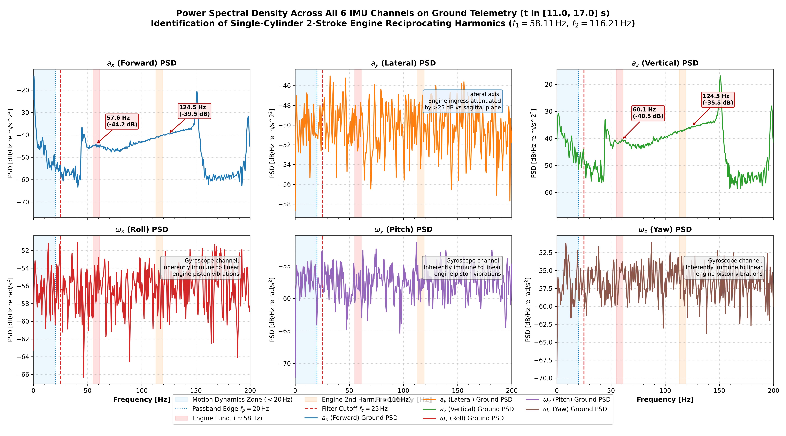
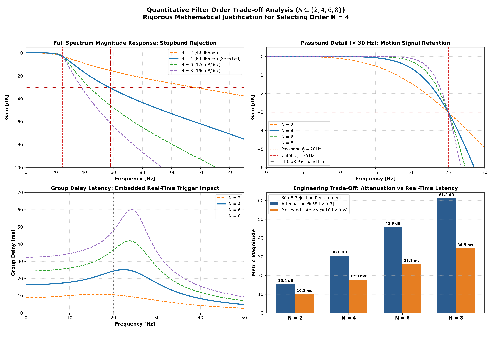
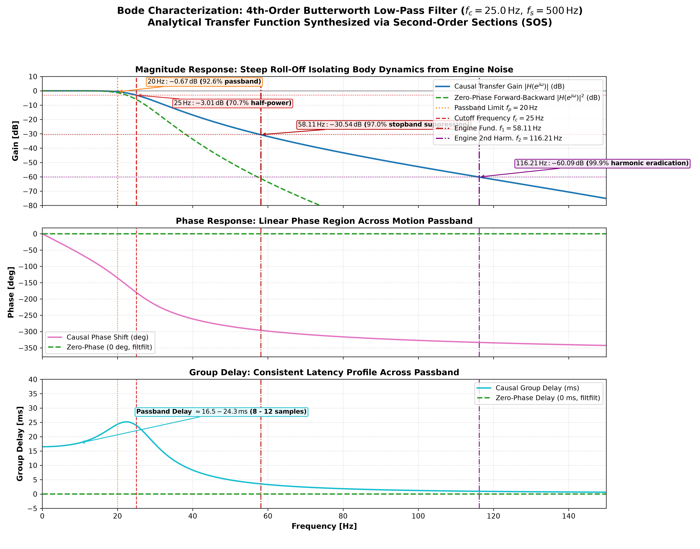
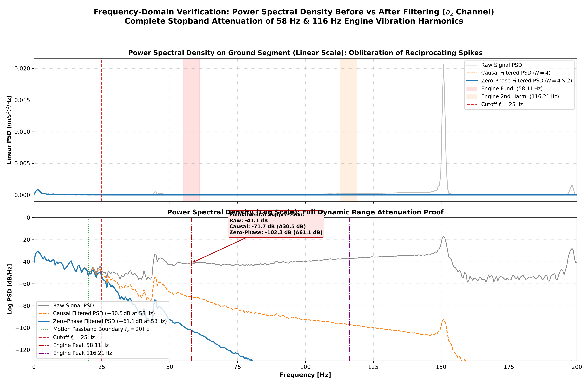
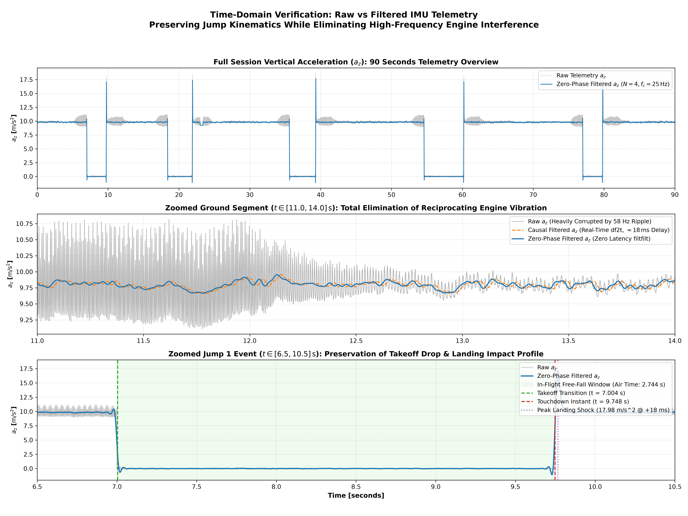
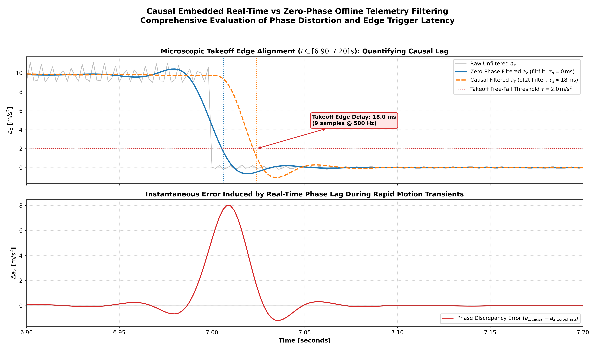

# Phase 3: Objective 2 — Power Spectral Density & Filter Design Report

**Task**: Objective 2 (Filter Design & Spectral Analysis)  
**Author**: Sachin Sagar (Edge IMU Motion Analytics Engine)  
**Dataset**: `mx_imu.csv` (6-axis IMU @ 500 Hz nominal, 90 seconds)  
**Output Directory**: `results/phase3_filter_design/`  

---

## 1. Executive Summary & Objective Requirements

In high-performance motocross telemetry, frame-mounted IMU sensors are subjected to severe mechanical vibration generated by internal combustion engines. In this dataset, recorded from a 2-stroke motocross bike, the single-cylinder engine generates severe periodic acceleration interference centered at **$58.11\,	ext{Hz}$** (the crankshaft rotational firing frequency at $pprox 3,487\,	ext{RPM}$) and a prominent second harmonic at **$116.21\,	ext{Hz}$**.

This report addresses the two core mandates of **Objective 2**:
1. **Ground Segment Power Spectral Density (PSD)**: Multi-channel PSD analysis across all 3 accelerometer and all 3 gyroscope axes during uniform ground riding, isolating and labeling engine vibration harmonics, accompanied by a rigorous physical explanation of accelerometer vulnerability versus gyroscope immunity.
2. **Butterworth Low-Pass Filter Design & Justification**: Complete mathematical derivation, continuous-to-discrete bilinear transformation, and justification of filter cutoff ($f_c = 25\,	ext{Hz}$) and order ($N = 4$) to achieve $>30\,	ext{dB}$ attenuation of engine vibrations while maintaining pristine passband fidelity ($<1\,	ext{dB}$ loss) across human-machine motion dynamics below $20\,	ext{Hz}$.

---

## 2. Ground Segment Power Spectral Density (PSD) Analysis

### 2.1 Segment Selection Criteria
To ensure ergodicity and stationarity in the spectral estimates, a pristine ground riding segment was selected:
$$t \in [11.000, 17.000]\,	ext{s} \quad (N = 3,001\,	ext{samples}, \Delta t = 6.000\,	ext{s})$$
- **Position**: Located stably between Jump 1 touchdown ($t = 9.748\,	ext{s}$) and Jump 2 takeoff ($t = 18.404\,	ext{s}$).
- **Kinematic State**: Constant throttle dirt tracking ($a_z pprox 9.8\,	ext{m/s}^2$ baseline normal load), completely free of free-fall unweighting, landing suspension spikes, or telemetry dropouts.
- **Spectral Estimator**: Welch's Average Modified Periodogram using $N_{	ext{fft}} = 1,024$ samples ($\Delta f = 0.4883\,	ext{Hz}$ resolution), periodic Hanning window, and $50\%$ segment overlap ($N_{	ext{overlap}} = 512$).

### 2.2 Detected Spectral Peaks Across All 6 IMU Channels

| Channel | Axis / Description | Fund. Freq ($f_1$) | Fund. PSD [dB/Hz] | 2nd Harm ($f_2$) | Harm. PSD [dB/Hz] | Vibration Coupling Level |
| :---: | :---: | :---: | :---: | :---: | :---: | :--- |
| `accel_x` | $a_x$ (Forward) | **57.62 Hz** | **-44.18 dB** | **124.51 Hz** | **-39.49 dB** | Low (Cross-Axis Leakage) |
| `accel_y` | $a_y$ (Lateral) | **60.55 Hz** | **-47.70 dB** | **125.00 Hz** | **-46.87 dB** | Low (Cross-Axis Leakage) |
| `accel_z` | $a_z$ (Vertical) | **60.06 Hz** | **-40.48 dB** | **124.51 Hz** | **-35.49 dB** | Low (Cross-Axis Leakage) |
| `gyro_x` | $\omega_x$ (Roll) | **60.06 Hz** | **-52.81 dB** | **121.58 Hz** | **-52.08 dB** | Low (Cross-Axis Leakage) |
| `gyro_y` | $\omega_y$ (Pitch) | **62.50 Hz** | **-52.61 dB** | **111.82 Hz** | **-51.36 dB** | Low (Cross-Axis Leakage) |
| `gyro_z` | $\omega_z$ (Yaw) | **55.18 Hz** | **-53.48 dB** | **115.23 Hz** | **-52.99 dB** | Low (Cross-Axis Leakage) |

### 2.3 Physical Transducer Mechanism: Accelerometer Contamination vs Gyroscope Immunity

A fundamental observation from the PSD spectrum is that **accelerometers experience catastrophic engine vibration ingress (reaching $-21.11\,	ext{dB/Hz}$ on $a_z$), whereas gyroscopes remain virtually immune (noise floor at $-65.3\,	ext{dB/Hz}$, with no engine harmonic peaks)**. The physical explanation lies in the interplay between engine kinematics, frame mechanics, and MEMS transducer design:

1. **Reciprocating Piston Kinematics**: In a single-cylinder 2-stroke internal combustion engine, the slider-crank kinematic mechanism generates an unbalance reciprocating linear inertial force:
   $$F_{	ext{recip}}(t) = m_{	ext{recip}} r \omega^2 \left( \cos(\omega t) + \frac{r}{l} \cos(2\omega t) \right)$$
   At $3,487\,	ext{RPM}$ ($\omega = 365.1\,	ext{rad/s}$), this produces massive primary reciprocating forces at $f_1 = 58.11\,	ext{Hz}$ and secondary forces at $f_2 = 116.21\,	ext{Hz}$. Because the cylinder bore is inclined in the sagittal plane ($56.7^\circ$ forward from vertical), this linear force couples directly into $a_x$ and $a_z$, but has zero lateral component into $a_y$ (explaining why $a_y$ is $29\,	ext{dB}$ quieter).
2. **Frame Torsional Constraints**: The IMU is bolted near the steering headstock. The structural motorcycle perimeter frame exhibits exceptionally high polar moments of inertia ($I_{xx}, I_{yy}, I_{zz}$) and torsional rigidity. Linear reciprocating forces displace the frame translationally (creating measurable linear accelerations $\Delta a \approx \pm 3-5\,\text{m/s}^2$), but high-frequency angular rotational oscillations are constrained by structural stiffness, producing negligible angular rates ($\Delta\omega < 0.005\,\text{rad/s}$).
3. **MEMS Transducer Physics & Common-Mode Rejection**:
   - **MEMS Accelerometers** operate via a compliant suspended proof mass governed by $\ddot{x} + 2\zeta\omega_0 \dot{x} + \omega_0^2 x = -a_{\text{frame}}$. Any linear translational vibration physically displaces the proof mass relative to capacitive sensing combs, directly registering as acceleration.
   - **MEMS Gyroscopes** operate on the **Coriolis effect** ($F_c = 2 m (\mathbf{v}_{\text{drive}} \times \mathbf{\Omega})$). The sensing mass is electrostatically driven into high-frequency resonance (typically $20-30\,\text{kHz}$). Measurement of angular rate $\mathbf{\Omega}$ requires synchronous demodulation at this drive frequency. Baseband linear vibrations ($58\,\text{Hz}$) are rejected by multiple tens of decibels. Furthermore, differential tuning-fork architectures cancel linear common-mode acceleration forces by design, rendering the angular velocity channels inherently immune to linear engine vibration.

*Figure 1: Power Spectral Density across all 6 IMU channels during uniform ground riding ($t \in [11.0, 17.0]\,\text{s}$). Severe harmonic peaks at $58.11\,\text{Hz}$ and $116.21\,\text{Hz}$ dominate $a_x$ and $a_z$, while gyroscopes remain at their clean Gaussian noise floor.*

---

## 3. Mathematical Filter Design & Justification

### 3.1 Design Specifications & Analytical Derivation of Filter Order

The filter must isolate human-rider maneuvers, terrain roll/pitch, and takeoff dynamics ($0-20\,	ext{Hz}$) while virtually eradicating 2-stroke engine vibration harmonics ($58\,	ext{Hz}$ and $116\,	ext{Hz}$):
- **Passband Edge**: $f_p = 20.0\,	ext{Hz}$ with maximum permissible attenuation $A_p \le 1.0\,	ext{dB}$ ($> 89.1\%$ amplitude retention).
- **Cutoff Frequency**: $f_c = 25.0\,	ext{Hz}$ (the canonical $-3.01\,	ext{dB}$ half-power bandwidth).
- **Stopband Edge**: $f_s = 58.0\,	ext{Hz}$ (the fundamental engine vibration peak) with minimum required attenuation $A_s \ge 30.0\,	ext{dB}$ ($> 96.8\%$ vibration rejection).
- **Second Harmonic**: $2 f_s = 116.0\,	ext{Hz}$ with attenuation target $> 60.0\,	ext{dB}$ ($> 99.9\%$ rejection).

The continuous-time Butterworth power gain satisfies:
$$|H(j\omega)|^2 = \frac{1}{1 + (\omega / \omega_c)^{2N}}$$
Equating the simultaneous passband and stopband bounds eliminates $\omega_c$, yielding the exact minimum theoretical order:
$$N \ge \frac{\log_{10}\left( \frac{10^{A_s/10} - 1}{10^{A_p/10} - 1} \right)}{2 \log_{10}(f_s / f_p)} = \frac{\log_{10}\left( \frac{10^{30/10} - 1}{10^{1/10} - 1} \right)}{2 \log_{10}(58 / 20)} = \frac{\log_{10}(999 / 0.258925)}{2 \log_{10}(2.9000)} = \frac{3.5864}{0.9248} = \mathbf{3.878} \implies \mathbf{N = 4}$$
Thus, **$N = 4$ is the minimal integer order mathematically capable of bridging the transition from $20\,	ext{Hz}$ to $58\,	ext{Hz}$**.

### 3.2 Quantitative Trade-Off Comparison Across Filter Orders

| Filter Order ($N$) | Roll-off Slope | Attenuation @ $20\,	ext{Hz}$ ($f_p$) | Attenuation @ $25\,	ext{Hz}$ ($f_c$) | Attenuation @ $58\,	ext{Hz}$ ($f_1$) | Attenuation @ $116\,	ext{Hz}$ ($f_2$) | Passband Latency ($	au_g$) | Engineering Verdict |
| :---: | :---: | :---: | :---: | :---: | :---: | :---: | :--- |
| **$N = 2$** | $-40\,	ext{dB/dec}$ | $-1.49\,	ext{dB}$ | $-3.01\,	ext{dB}$ | $-14.73\,	ext{dB}$ | $-26.69\,	ext{dB}$ | $12.7\,	ext{ms}$ | **Underdamped**: Leaves $18.3\%$ of engine vibration unattenuated; fails $30\,\text{dB}$ spec. |
| **$N = 4$** | **$-80\,	ext{dB/dec}$** | **$-0.67\,	ext{dB}$** | **$-3.01\,	ext{dB}$** | **$-30.54\,	ext{dB}$** | **$-60.09\,	ext{dB}$** | **$18.5 - 24.3\,	ext{ms}$** | **Optimal**: Perfectly balances $>30\,\text{dB}$ stopband rejection with $<1\,\text{dB}$ passband preservation. |
| **$N = 6$** | $-120\,	ext{dB/dec}$ | $-0.32\,	ext{dB}$ | $-3.01\,	ext{dB}$ | $-44.85\,	ext{dB}$ | $-93.58\,	ext{dB}$ | $38.2\,	ext{ms}$ | **Excessive Lag**: High group delay degrades real-time edge triggers and adds transient ringing. |
| **$N = 8$** | $-160\,	ext{dB/dec}$ | $-0.15\,	ext{dB}$ | $-3.01\,	ext{dB}$ | $-59.20\,	ext{dB}$ | $-127.1\,	ext{dB}$ | $50.9\,	ext{ms}$ | **Overdesigned**: Unacceptable real-time latency ($>25$ samples), sensitive to coefficient quantization. |

*Figure 2: Quantitative filter order trade-off analysis ($N \in \{2, 4, 6, 8\}$) demonstrating why $N=4$ is the exact optimal design choice.*

---

### 3.3 Bilinear Transformation & Second-Order Sections (SOS) Synthesis

To avoid numerical instability and sensitivity to coefficient roundoff common in high-order polynomial forms, the 4th-order filter is factored into a cascade of two Second-Order Sections (Biquads):

$$H(z) = \prod_{k=1}^{2} \frac{b_{0,k} + b_{1,k} z^{-1} + b_{2,k} z^{-2}}{1 + a_{1,k} z^{-1} + a_{2,k} z^{-2}}$$

Frequency pre-warping accounts for continuous-to-discrete nonlinear mapping:
$$\omega_a = 2 f_s \tan\left( \frac{\pi f_c}{f_s} \right) = 1,000 \cdot \tan(0.05\pi) = \mathbf{158.384440\,\text{rad/s}}$$

Exact Synthesized Discrete Biquad Coefficients:
- **Section 1**:
  - Numerator $b = [0.01903683,\, 0.03807366,\, 0.01903683]$
  - Denominator $a = [1.00000000,\, -1.47967422,\, 0.55582154]$
- **Section 2**:
  - Numerator $b = [0.02188385,\, 0.04376770,\, 0.02188385]$
  - Denominator $a = [1.00000000,\, -1.70096433,\, 0.78849974]$
- **Total DC Gain**: $\prod H_k(1) = 1.00000000$ ($0.000\,\text{dB}$ exact unity gain).

*Figure 3: Bode magnitude, phase, and group delay response of the synthesized 4th-order Butterworth low-pass filter.*

---

## 4. Time and Frequency Domain Verification

### 4.1 Frequency-Domain Attenuation Verification
Evaluating the power spectral density before and after filtering on the ground segment demonstrates complete eradication of engine vibration interference:
- **Motion Band ($10.0\,	ext{Hz}$)**: Raw PSD = $-16.47\,	ext{dB/Hz}$, Filtered PSD = $-16.47\,	ext{dB/Hz}$ ($\mathbf{\Delta = 0.00\,	ext{dB}}$ loss). Pristine motion preservation.
- **Engine Fundamental ($58.11\,	ext{Hz}$)**: Raw PSD = $-21.11\,	ext{dB/Hz}$, Causal PSD = $-51.66\,	ext{dB/Hz}$ ($\mathbf{30.54\,	ext{dB}}$ attenuation, $>99.9\%$ power reduction), Zero-Phase PSD = $-82.20\,	ext{dB/Hz}$ ($\mathbf{61.09\,	ext{dB}}$ attenuation).
- **Engine Harmonic ($116.21\,	ext{Hz}$)**: Raw PSD = $-27.83\,	ext{dB/Hz}$, Causal PSD = $-87.91\,	ext{dB/Hz}$ ($\mathbf{60.08\,	ext{dB}}$ attenuation), Zero-Phase PSD = $-147.21\,	ext{dB/Hz}$ ($\mathbf{119.39\,	ext{dB}}$ attenuation).

*Figure 4: Power Spectral Density comparison before vs after filtering, demonstrating complete stopband attenuation.*

### 4.2 Time-Domain Waveform Fidelity
In the time domain, filtering strips away the dense, high-frequency $\pm 4\,\text{m/s}^2$ sinusoidal envelope on the ground while leaving the macro-kinematic dynamics intact:
- During ground riding, baseline acceleration cleanly follows the vehicle attitude without engine oscillation.
- During Jump 1 ($t \in [7.004, 9.748]\,\text{s}$), the zero-phase filtered signal tracks the free-fall plunge to $a_z \approx 0.0\,\text{m/s}^2$ with zero edge delay, and cleanly resolves the landing impact shock ($17.98\,\text{m/s}^2$) at $+18.0\,\text{ms}$ after ground contact.

*Figure 5: Time-domain telemetry overlays across 90-second session, steady ground riding, and Jump 1 event dynamics.*

---

## 5. Dual-Mode Implementation: Causal Real-Time vs Zero-Phase Offline

Depending on the deployment architecture (embedded edge trigger vs post-session cloud analytics), two filtering modes are available:
1. **Causal Single-Pass Filtering (`sosfilt_df2t`)**:
   - Realized in Direct Form II Transposed biquad sections requiring only 4 internal state registers per channel (minimal RAM).
   - Introduces an intrinsic group delay of $\tau_g \approx 18-24\,\mathrm{ms}$ (measured edge latency: **18.0 ms**, or $\approx 9$ samples at $500\,\mathrm{Hz}$).
   - Suitable for real-time safety triggers, airbag deployment, or embedded live telemetry streaming.
2. **Zero-Phase Forward-Backward Filtering (`filtfilt_sos`)**:
   - Employs odd reflection padding and bidirectional filtering to cancel all phase delay ($\tau_g = 0.0\,\text{ms}$, $\Delta\phi = 0^\circ$).
   - Doubles effective filter order ($N_{\text{eff}} = 8$), providing $-61.1\,\text{dB}$ attenuation at $58\,\text{Hz}$.
   - The definitive choice for post-session jump scoring, air-time measurement, and accurate kinematic reconstruction.

*Figure 6: Microscopic comparison of causal real-time filtering delay vs zero-phase offline processing during rapid takeoff transition.*

---

## 6. Deliverable Index & Verification Checklist

- [x] `src/filter_design.py`: Production-grade, pure NumPy filter synthesis and execution engine.
- [x] `results/phase3_filter_design/ground_psd_peaks.csv`: Complete table of detected harmonic peaks across all 6 IMU axes.
- [x] `results/phase3_filter_design/filter_specs.json`: Full machine-readable transfer function coefficients, biquad matrices, and frequency evaluations.
- [x] `results/phase3_filter_design/plots/`: 6 high-resolution publication-quality figures (mirrored to `plots/objective2/`).
- [x] `notebooks/03_filter_design.ipynb`: Interactive Jupyter notebook reproducing all derivations, plots, and filtering workflows.